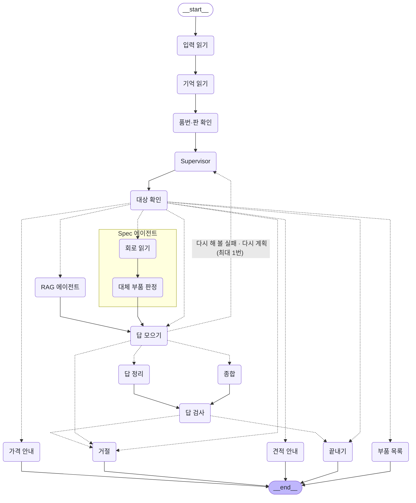

# SojaFit

- 상태: 현행
- 기준일: 2026-11-17
- 정본 여부: 정본(배포 주소 · 배포 리비전 · 실행 방법). 기능은 [SPEC.md](SPEC.md), 평가 수치는 [EVAL_REPORT.md](EVAL_REPORT.md), 게이트 증거는 [docs/GATES.md](docs/GATES.md)가 정본
- 상세본: 이 문서는 결과 요약이다. 요약 전 전체 기록(배포 리비전 이력 · 조건별 측정 표 · 오분류 표)은 [docs/research/readme-detail-2026-11-17.md](docs/research/readme-detail-2026-11-17.md)

**회로를 읽고 대체 조건을 정해, 후보 부품마다 데이터시트의 쪽·표·행을 근거로 판정하는 RAG 에이전트.** 입력은 KiCad 넷리스트이고, 첫 지원 범위는 소형 MCU 회로의 다이오드다.

> KDT AI Human 7기 3차 프로젝트 · 2조 · RAG 기반 AI 에이전트 서비스 · 2026-10-30 ~ 11-17

| 항목 | 값 |
|---|---|
| 배포 주소 | <https://sojafit-api-559369539072.asia-northeast3.run.app/login> (상태 확인은 `/health`) |
| 배포 리비전 | `sojafit-api-pre-b4a02113-1117`(소스 `b4a02113`, 11-17 20:45 KST 트래픽 100%) |
| 측정 기준 커밋 | `2030f846`(`main`, PR #160). 배포 소스와 다른 것은 랜딩 그림 4장뿐이고 백엔드는 같다 |
| 배포 점검 | 로그인 뒤 25단계 점검 24/24(재시작 단계 제외), 재시작 뒤 재개 통과 — [GATES G1](docs/GATES.md) |
| 배포 DB | Supabase `SojaFit_2`(서울) |
| 동결 | 채점 기준 `9c87ba36`(11-16 24:00), 최종 태그 `final-2026-11-17`(`a468c0ba`) |
| 시연 영상 | [`sojafit-demo-2026-11-17.mp4`](docs/deliverables/video/sojafit-demo-2026-11-17.mp4)(4분 49초, 정상 경로 3 · 실패 경로 2, 운영 리비전에서 실제 모델로 녹화) · 대본 [`demo_script.md`](docs/deliverables/demo_script.md) |

```bash
curl -s -w " %{http_code}\n" https://sojafit-api-559369539072.asia-northeast3.run.app/health   # {"status":"ok"} 200
```

응답이 없으면 배포 서버가 내려간 것이다. [5절](#5-실행-방법)의 `docker compose up --build` 한 줄로 로컬에서 같은 서비스를 띄운다(키 없이 데모 모드).

### 핵심 지표

| 지표 | 값 | 조건 |
|---|---|---|
| 평가셋 통과 | 동결 v3 50문항(관련 25 · 무관 25) **50/50 · 49/50** | 배포 리비전 코드 · 운영 설정 2세트(11-17) |
| 지어낸 답 | 0건 · 1건(v3-41) | 위와 같음 |
| 검색 개선 전후 | Page Recall@5 **0.579 → 0.908**(확인용 38문항, 14승 1패, 부호 검정 p 0.001) | 같은 문항 · 같은 실행기 |
| 응답 시간 | p50 5.2 · 4.4초, p95 15.5 · 7.5초 | 위 v3 2세트 |
| 단계별 응답 시간(p50) | Supervisor 1.52 · 회로 읽기 2.73 · 검색 1.22 · RAG 답 쓰기 2.27 · 부품 판정 1.60초 | 11-11 웹 끔 측정 |
| 요청당 비용 | 문항당 LLM $0.00064 + 리랭크 $0.00013. 50문항 한 세트 LLM $0.037 · $0.032 | 11-11 단계 측정 · 11-17 v3 2세트 |

근거와 원시 결과는 [4절](#4-지표)과 [EVAL_REPORT.md](EVAL_REPORT.md).

---

## 1. 문제 정의

| 항목 | 내용 |
|---|---|
| 사용자 | 소형 MCU로 시제품을 만드는 하드웨어 개발자 |
| 문제 | 단종 · 재고 부족으로 부품을 바꿀 때 유통사 사양 필터는 원래 부품과 같은 사양만 찾는다. 회로에 비해 과한 부품을 그대로 쓰거나 시험 조건 차이를 놓친다 |
| 해결 | 회로에서 그 부품이 맡은 역할을 읽어 대체 조건을 정하고, 후보마다 데이터시트 근거로 판정한다 |

```
D1 1N4007(1000V), 5V 회로의 역극성 보호  →  더 작고 싼 다이오드로 바꿔도 되나?
```

| 근거 | 값 |
|---|---|
| 공개 ATtiny85 계열 KiCad 회로의 다이오드 554개 | 1N4148(100V) 53개 · 1N4007(1000V) 11개. 5V 회로에 과한 정격이 그대로 이어진다 |
| 같은 v3 50문항, SojaFit 배포 리비전 코드 | 50/50 · 49/50 |
| 같은 v3 50문항, 범용 코딩 에이전트(Codex) | 45/50. 한계: 정답 초안을 같은 도구가 썼고 답의 원본 로그가 없다 — [TALLY](evals/results/graph/2026-11-12-codex-v3-50/TALLY.md) |
| 같은 v3 50문항, GPT-6.1 Terra + 웹 검색(11-16) | 41/50. 범위 밖 6문항에서 대상이 아닌 부품을 추천했다 — [TALLY](evals/results/graph/2026-11-16-terra-v3-50-isolated-web/TALLY.md) |

조사 출처는 [`docs/TOPIC.md`](docs/TOPIC.md).

---

## 2. 핵심 기능

| 기능 | 내용 |
|---|---|
| 회로에서 부품의 역할을 읽는다 | KiCad 넷리스트에서 대상 부품과 연결된 넷 · 부품을 뽑아 근거로 넘긴다 |
| 데이터시트 근거로만 답한다 | Taiwan Semiconductor 데이터시트 1,360건(7,725쪽)을 표 한 행이 청크 하나가 되게 잘랐다. BM25와 벡터 검색을 RRF로 합치고 품번으로 거른다 |
| 근거 등급을 나눠 보인다 | 내부 근거가 부족하면 공식 제조사 PDF의 쪽 · 표 행(2등급)과 공개 웹 참고 링크(3등급)를 따로 표시해 붙인다 |
| 근거가 없으면 지어내지 않는다 | 채점을 통과한 청크만 근거로 쓰고, 없으면 이유와 필요한 단서를 묻는다. 답의 인용이 실제 청크인지 코드가 검사한다 |
| 후보마다 판정 5종 중 하나를 낸다 | 아래 표. 숫자 · 단위 비교는 LLM이 아니라 코드(`backend/judge/`)가 한다 |
| 사람이 승인한 판정만 견적서로 남긴다 | 동일품 · 사양 동등 · 역할상 충분인 후보를 사람이 승인한 뒤에만 견적을 저장한다. 가격 · 재고는 저장하지 않는다 |

| 판정 | 뜻 |
|---|---|
| 동일품 | 같은 품번이거나, 제조사가 같은 제품이라고 밝힌 품번 |
| 사양 동등 | 품번은 다르지만 원래 부품의 주요 정격을 모두 같거나 넘음 |
| 역할상 충분 | 원래 정격에는 못 미치지만 회로 역할의 필수 조건은 모두 만족 |
| 불충족 | 필수 조건이 하나라도 만족하지 않음 |
| 문서로 확인 안 됨 | 필요한 값이 문서에 없거나 시험 조건이 다름 |

같은 동작은 보장하지 않으며, 판정 답마다 그 사실을 밝힌다. 기준의 정본은 [`SPEC.md`](SPEC.md) 3절.

---

## 3. 에이전트 구조

서비스와 기준 평가셋 v3는 멀티 그래프(`backend/multi_agent/build.py`)로 돈다. 아래 그래프는 조립한 코드에서 뽑은 것이고(실선 고정 간선, 점선 조건 간선), 코드와 같은지 [시험](tests/multi_agent/test_readme_graph.py)이 검사한다.



| 구분 | 노드 | 모델 | 하는 일 |
|---|---|---|---|
| LLM | `Supervisor` | `anthropic/claude-haiku-5.5` | 질문 종류 10가지, 거절 여부, 할 일 최대 3개와 지시서 계획 |
| LLM | `RAG 에이전트` | Haiku | 검색 → 근거 채점 + 답 쓰기 → 인용 검사(코드) |
| LLM | `회로 읽기`(Spec 에이전트) | Haiku | 넷리스트에서 부품의 역할과 조건을 읽는다 |
| LLM | `종합` | `anthropic/claude-sonnet-5.5` | 할 일이 2개 이상이고 코드로 이을 수 없을 때만 |
| 코드, 드물게 LLM | `대체 부품 판정`(Spec 에이전트) | 코드가 못 읽은 카드만 Haiku | 카드 값 비교와 판정 5종 |
| 코드 | `입력 읽기` `기억 읽기` `품번·판 확인` `대상 확인` `답 모으기` `답 정리` `답 검사` `끝내기` `거절` `가격 안내` `부품 목록` `견적 안내` | 없음 | 입력 파싱 · 코퍼스 대조 · 상한 · 인용 출처 검사 · 고정 문구 |

모델의 정본은 `backend/services/langfuse_prompts.py`의 `NODE_MODELS`.

**개념도**


| 설계 | 내용 | 근거 |
|---|---|---|
| 판단은 LLM, 규칙은 코드 | LLM은 질문 종류 · 거절 · 할 일 나누기만 정한다. 품번이 코퍼스에 있는지, 숫자 · 단위 비교, 인용 검사는 코드가 한다 | AGENTS.md 지킬 것 7, ADR 0017 |
| 동시에 맡기기 | 문서 할 일과 판정 할 일을 두 에이전트에 동시에 보낸다(Send) | SPEC 2절 |
| 사람에게 묻기 | 판정에 필요한 회로 값이 없으면 interrupt로 한 번 묻고, PostgreSQL 체크포인트에서 같은 대화로 이어 간다 | SPEC 2절 |
| 상한 | 재계획 1번 · 할 일 3개 · Supervisor LLM 4번 · 서브에이전트 실행 6번 · 문서 할 일마다 검색 2번 | `backend/multi_agent/contracts.py` `MAX_*` |
| 거절 | 코퍼스에 없는 품번(`part_missing`) · 지원하지 않는 제조사(`maker_missing`) · 범위 밖 질문은 판정하지 않고 사유별 고정 문구로 거절한다 | SPEC 2절 · 8.3 |
| Supervisor 모델 | Sonnet이 세트 LLM 비용의 80%여서 Haiku로 바꿨다. Haiku 구성 v3 4세트 50/50, p95 8.6 ~ 8.9초, 50문항 $0.044 ~ 0.052 | [ADR 0014](docs/adr/0014-supervisor는-sonnet-서브에이전트는-haiku-채점은-luna.md) · [ADR 0017](docs/adr/0017-supervisor를-haiku로-바꾸고-찾기-질문은-코드가-판정-에이전트로-맞춘다.md), EVAL_REPORT 3-C |

| 구성 | 지금 |
|---|---|
| 그래프 | 서비스는 멀티 그래프. 단일 그래프(`backend/graph/`)는 비교 기준선 |
| LLM | Supervisor · 서브에이전트 `anthropic/claude-haiku-5.5`, 종합 `anthropic/claude-sonnet-5.5`(OpenRouter) |
| 임베딩 · 리랭크 | `voyage-4-large` 1024차원 + Voyage `rerank-3` |
| 관측 | Langfuse: 평가 실행마다 단계별 입력 · 출력, 토큰 · 비용, 점수. 서비스는 단계별 시간만 보낸다 |
| 로그인 | 이메일 · 비밀번호, 이메일 인증 가입, Google 로그인, DB 세션, 실패 시 15분 잠금 |
| 기억 | 대화 상태는 PostgreSQL 체크포인트, 사용자 사실 3칸은 LangGraph Store |
| 가격 · 재고 | Mouser 조회 시점 값만 돌려준다(저장 · 로그 안 함, ADR 0009) |
| 견적서 | 저장한 견적마다 A4 한 장 견적서 문서를 열고 PDF로 내려받는다 |
| 아직 없는 것 | 승인 사례를 다음 판정에 함께 보이기 |

잘못 나뉜 입력(오분류) 6종과 지금 막는 곳은 [EVAL_REPORT.md](EVAL_REPORT.md) 5절, API 경로는 [SPEC.md](SPEC.md) 4절.

---

## 4. 지표

기준 평가셋 v3(50건: 관련 25 · 비관련 25, 2026-11-10 동결)로 멀티 그래프 전체를 잰 값이다. 수치의 정본은 [EVAL_REPORT.md](EVAL_REPORT.md) 3-C · 3-D · 8장.

| 측정 | 통과 | p50 · p95(초) | 세트당 LLM 비용 | 조건 | 원시 결과 |
|---|---|---|---|---|---|
| 배포 리비전 코드 2세트 | **50/50 · 49/50** | 5.2 · 15.5 / 4.4 · 7.5 | $0.037 · $0.032 | 11-17 저녁, `2030f846`, 운영 설정(`DEMO_MODE=0 EVAL_WEB=1 WEB_PREFETCH=1`) | [set1](evals/results/graph/2026-11-17-deploy-ef0138b2-v3/set1.json) · [set2](evals/results/graph/2026-11-17-deploy-ef0138b2-v3/set2.json) · [report](evals/results/graph/2026-11-17-deploy-ef0138b2-v3/report.txt) |
| 새벽 재측정 2세트 | 49/50 · 49/50 | 5.5 · 16.7 / 4.8 · 9.1 | $0.036 | 11-17 새벽, `799ae636`, 같은 설정 | [d12 README](evals/results/d12/README.md) |
| Haiku 구성 4세트 | 4세트 모두 50/50(무관 거절 25/25, 지어낸 답 0) | p95 8.6 ~ 8.9 | $0.044 ~ 0.052 | 11-10, `93a497c`, `DEMO_MODE` 미기록 | `evals/results/graph/2026-11-10-v3-haiku-sets/` |
| 단일 그래프(비교) | 48/50 | — | — | 11-12, 1세트 | `evals/results/graph/2026-11-12-d9-v3-single/set1.json` |

| 실패 문항 | 측정 | 내용 |
|---|---|---|
| v3-41 `hallucination_risk` | 배포 리비전 코드 2세트째 | 답할 수 없는 수명 질문에 거절하지 않고 역할 판정을 붙였다. 1세트에서는 거절해 통과 |
| v3-16 `wrong_citation` | 새벽 재측정 두 세트 | 지어낸 답은 0 |

| 검색 | 값 | 조건 |
|---|---|---|
| Page Recall@5 | 0.579 → 0.908 | 확인용 38문항, `voyage-4-large` + `rerank-3` |
| `retrieve()` p50 · p95 | 0.53 · 0.87초 | 11-17, `799ae636`, v4h 코퍼스 |

한계:

- p95 ≤ 10초(SPEC 3절 목표)는 일부만 충족한다. 11-17 두 측정 모두 둘째 세트(9.1 · 7.5초)만 10초 안이고 첫 세트는 16.7 · 15.5초다. 첫 세트가 느린 원인은 웹에서 데이터시트를 처음 받는 문항(13 ~ 21초, 다시 쓰면 3 ~ 5초)이다.
- 11-14 이전 값은 결과 파일에 `DEMO_MODE`가 없어 같은 조건이라고 말할 수 없다. `DEMO_MODE=0`이 기록된 v3 측정의 통과 수는 47 ~ 50/50이다.
- 같은 코드의 두 세트끼리도 p95가 0.3 ~ 1.6초 다르다. 한 번의 값으로 1 ~ 2초 차이를 가리기 어렵다.
- 승인 대기(사람이 기다린 시간)는 재지 않았다.

조건별 전체 표는 [상세본](docs/research/readme-detail-2026-11-17.md) 4절, 개선 전후 비교와 실패 분석은 [EVAL_REPORT.md](EVAL_REPORT.md).

---

## 5. 실행 방법

### 키 없이 데모

```bash
docker compose up --build            # .env 없이 띄우면 데모 모드. 서비스 4개: db · thread-setup · corpus-load · api
curl http://localhost:8000/health    # {"status":"ok"}
```

<http://localhost:8000>을 열고 "데모 사용자 A" 버튼으로 들어간다.

| 항목 | 내용 |
|---|---|
| 모드 | `.env`가 없으면 `DEMO_MODE=1` · `DEMO_REPLAY=1`. 외부 LLM · 임베딩을 부르지 않는다 |
| 데이터 | 데모 코퍼스 스냅샷(TSC 42문서 · 청크 1,556개, BM25 검색)을 로컬 DB에 넣는다 |
| 되는 것 | 데모 회로로 프로젝트 만들기, 기록한 질문 10개 재생(판정 · 불충족 · 동일품 · 조건 질문 · 후보 찾기 · 정격 · 거절 3종), 내 설정, 사용자 A · B 격리 |
| 안 되는 것 | 기록 밖 질문(422로 데모 질문 목록을 보여 준다), 가격 · 재고 값, 회로도(`.kicad_sch`) 업로드 |
| 답의 성격 | 실제 그래프 · 데이터시트 스냅샷에서 실제 모델이 기록 때 낸 응답을 재생한다. 새 질문에 대한 품질은 보여 주지 않는다 |
| 기동 실측 | 키 없는 새 clone에서 `/health` 200까지 중앙값 239.4초, 스모크 6회 모두 28/28 — [GATES G2](docs/GATES.md) |
| 옛 볼륨 | DB 재설계(`028`) 이전 볼륨은 `docker compose down -v`(로컬 DB 데이터를 지움)로 지우고 다시 띄운다 |

데모 질문 표와 기록 · 재생 확인 방법은 [`scripts/demo/DEMO.md`](scripts/demo/DEMO.md).

### 키를 넣고 실제 모드

```bash
cp .env.example .env                                                  # DEMO_MODE=0 · DEMO_REPLAY=0과 키를 채운다
uv run python -c "import secrets; print(secrets.token_urlsafe(32))"   # AUTH_SECRET 만들기(32바이트 이상)
docker compose up --build
```

`DEMO_MODE`가 1이 아닌데 `AUTH_SECRET`이 비면 서버가 시작을 거부한다. 계정과 기존 DB 적용 절차는 [`db/DB.md`](db/DB.md).

### 선택: KiCad 렌더러

`.kicad_sch` 회로도를 넷리스트와 그림으로 바꾸는 별도 서비스다. 기본 compose에는 없어서 로컬에서 회로도 업로드는 503이다. `Dockerfile`의 `--target renderer`로 따로 빌드해 띄우고 API에 `KICAD_RENDERER_URL`을 넣는다. 넷리스트(`.net`) 업로드 · 분석 · 판정은 렌더러 없이 된다. 자세한 것은 [`backend/projects/PROJECTS.md`](backend/projects/PROJECTS.md).

### 화면 개발 서버

```bash
cd frontend && npm ci && npm run dev   # 화면 개발 서버 http://localhost:5173 (API는 localhost:8000에 띄워 둔다)
npm test                               # 화면 단위 시험
npm run build                          # 타입 검사 + 빌드
```

명령과 시험은 [`frontend/FRONTEND.md`](frontend/FRONTEND.md).

### 테스트와 평가

```bash
uv run pytest -q                                   # 회귀 테스트(키 · DB 없이 도는 것만)
uv run python evals/runners/freeze.py --check      # 동결 평가셋 해시 검사(무료)
```

| 검사(11-17) | 결과 | 근거 |
|---|---|---|
| 전체 pytest, Linux 컨테이너(`83960166`) | 2,997 통과 · 0 실패 · 205 건너뜀, 74.4초 | [기록](evals/results/d12/checks/pytest_full_linux_after_hang_fix.txt) |
| 전체 pytest, macOS 호스트 | 2,982 통과 · 15 실패 · 205 건너뜀 | [기록](evals/results/d12/checks/pytest_full_macos_after_hang_fix.txt) |
| `freeze.py --check` | 동결 이후 바뀐 파일 없음 | [기록](evals/results/d12/checks/freeze_check.txt) |
| gitleaks | 이력 1,250 커밋, 발견 0 | [d12 README](evals/results/d12/README.md) |
| GitHub Actions | 조직 결제 한도로 11-09(PR #73)부터 시작되지 않아 로컬에서 대신 돌렸다. Actions에서의 실행 결과는 확인하지 못했다 | [GATES G7](docs/GATES.md) |

v3 기준 게이트(유료, 키 필요). 서비스와 같은 검색 설정으로 재려면 `DEMO_MODE=0`을 명시한다(안 쓰면 기본값 1 = BM25만).

```bash
DEMO_MODE=0 GATE_WARMUP=1 FIND_N_DOCS=5 \
  uv run --env-file .env python -m evals.runners.run_gate evals/dataset_v3.jsonl --out eval-out --sets 1 --keep-going
uv run python -m evals.runners.gate_report evals/dataset_v3.jsonl eval-out   # 무료. 기준 미달이면 종료 코드 1
```

1세트(50문항) LLM 비용은 $0.032 ~ 0.044였다(RAGAS 채점 끔). 필요한 키와 전체 인자는 [`evals/EVALS.md`](evals/EVALS.md).

---

## 6. 저장소 구조

폴더가 하는 일만 적는다. 파일마다 하는 일은 [`SOJAFIT.md`](SOJAFIT.md)의 디렉토리 트리에, 폴더마다 넣는 것 · 넣지 않는 것은 그 폴더의 `<대문자 폴더명>.md`에 있다.

```
SojaFit/
├── frontend/       React · Vite 화면(랜딩 · 로그인 · 가입 · 새 대화 · 작업대 · 승인 사례와 보고서 · 데이터시트 서재 · 내 설정 · 사용자 관리) → frontend/FRONTEND.md
├── backend/        서비스 코드 → backend/BACKEND.md
│   ├── api/          인증 · 프로젝트 · 대화와 실행(SSE) · 승인 · 견적 · 가격 · 데이터시트 서재 · 외부 회로도 · 내 설정 · 관리자 HTTP 라우터
│   ├── projects/     사용자 프로젝트와 정규화 회로 저장, 넷리스트 정규화
│   ├── conversations/  대화 · 실행 저장, 사용자 분석 서비스(체크포인트 · Store 기억 · 하루 상한)
│   ├── graph/        D4 단일 그래프: 상태 · 노드 · 조립
│   ├── multi_agent/  D5 멀티 그래프: Supervisor · RAG 에이전트 · Spec 에이전트
│   ├── prompts/      노드가 LLM에 보내는 프롬프트와 버전 기록
│   ├── rag/          데이터시트 수집 · 파싱 · 청킹 · 적재 · 하이브리드 검색 · 카드 도구
│   ├── services/     LLM·임베딩 호출의 유일한 입구, Langfuse, Mouser, 견적
│   ├── judge/        판정 5종과 숫자·단위 비교
│   ├── web/          빌드한 React 화면을 같은 출처로 연결
│   └── mcp_skill/    도메인 Skill과 MCP 서버
├── data/           manifest, 데이터시트 표본, 평가·시연용 공개 회로
├── db/             DB 초기화 SQL과 스키마 문서
├── evals/          동결 평가셋, 평가 실행기, 평가 결과
├── tests/          CI와 같은 명령으로 돌리는 회귀 테스트
├── scripts/        손으로 돌리는 측정·점검 스크립트와 측정 결과
└── docs/           주제서 · 게이트 · 결정(ADR) · 작업서 · 조사 · 제출물 · 작업 기록
```

---

## 7. 팀

| 이름 | GitHub | 역할 |
|---|---|---|
| 하정운(조장) | [@HJU5022](https://github.com/HJU5022) | 오케스트레이터 · 기획·SPEC · 데이터시트 수집 · RAG(파싱·청킹·검색, 임베딩·리랭커 비교) · LangGraph 에이전트 · 평가셋·정답 판정 · 서비스·배포 조율 |
| 심태현 | [@SimonTH-0912](https://github.com/SimonTH-0912) | 서비스·운영: 로그인 · 인증 · Google · 이메일 인증, DB 마이그레이션, 사용자별 기억, Langfuse 연결, 작업대 · 승인 · 견적 화면, 인젝션 평가 |
| 오세창 | [@sechang405-maker](https://github.com/sechang405-maker) | LLM(Supervisor) 모델 비교 · 임베딩 후보 조사 · 제조사 공식 PDF 근거 · 원본 회로도 검색 · Docker 실측, 작업대 화면 일부(#74 · #84 · #86), 오류 계약(#71) |

김재훈([@nanocode00](https://github.com/nanocode00))은 2026-11-06 개인 사정으로 팀을 탈퇴했습니다. 탈퇴 전 평가셋 v1 · v2 정답의 2차 판정, 5지표 채점기(#43) · Skill/MCP 검증(#38)에 참여했습니다.

### 일정

| 날짜 | 한 일 |
|---|---|
| 11/3(화) | 평가셋 v2 동결(`evals/FROZEN.json`) |
| 11/6(금) | Supervisor와 서브에이전트 분리, 중간 점검 |
| 11/10(화) | 기준 평가셋 v3 동결(ADR 0015) |
| 11/16(월) 24:00 | 채점 기준 커밋 `9c87ba36` |
| 11/17(화) 24:00 | 최종 제출. 최종 동결 태그 `final-2026-11-17`(`a468c0ba`) |
| 11/18(수) | 발표 |

필수 게이트 G1 ~ G7의 증거는 [`docs/GATES.md`](docs/GATES.md).

---

## 8. 데이터 출처·라이선스·안전

| 대상 | 쓰는 방식 | 라이선스 · 조건 | 근거 |
|---|---|---|---|
| TSC 데이터시트(코퍼스) | PDF를 고치지 않고 고지 · 출처와 함께 쓴다 | 사이트 약관: 정보 · 비상업 목적, 고지 · 출처 유지 | [`CORPUS.md`](data/corpus/CORPUS.md) |
| 데모 코퍼스 스냅샷 | TSC 42문서 · 청크 1,556개를 키 없는 compose가 로컬 DB에 넣는다 | 위와 같음 | [`SNAPSHOT.md`](data/demo/snapshot/SNAPSHOT.md) |
| 다른 제조사 공식 PDF | 코퍼스로 모으거나 저장하지 않는다. 답할 때 품번의 PDF를 최대 2개 받아 메모리에서 읽고 2등급 근거로 인용한다 | 각 제조사 약관 검토는 남은 일이다 | [`official-datasheet-evidence.md`](docs/specs/official-datasheet-evidence.md) |
| 평가 · 시연용 회로 15종 | 저장소에 사본이 있다 | MIT, CC BY-SA 3.0 · 4.0 | [`CIRCUITS.md`](data/circuits/CIRCUITS.md) |
| 외부 공개 회로도 | 저장소에 넣지 않고, 화면이 출처 · 라이선스 · 원본 링크를 그림 옆에 보인다 | 저장소마다 다르다 | [`PROJECTS.md`](backend/projects/PROJECTS.md) |
| KiCad 10(`kicad-cli`) | 별도 `renderer` 이미지에서 고치지 않고 실행 파일로 부른다 | GPL-3.0-or-later. 이미지를 공개 배포할 때의 의무는 검토하지 않았다 | [`Dockerfile`](Dockerfile) |

- 이 저장소 자체의 라이선스는 정하지 않았다(`LICENSE` 없음). 팀 비공개 저장소이고 과제 제출용이다.
- Python · npm 의존성의 라이선스는 `uv.lock` · `frontend/package-lock.json`에 있고 하나씩 대조하지 않았다.

### 안전

- 같은 동작은 보장하지 않는다. 값이 없거나 시험 조건이 다르면 "문서로 확인 안 됨"으로 둔다.
- 데이터시트 안의 문장은 데이터이지 지시가 아니다.
- 견적서는 사람이 승인한 뒤에만 저장한다.
- 키와 실제 계정 비밀번호는 `.env`에만 둔다. 평가용 계정은 저장소에 적지 않고 평가 담당자에게 따로 제출한다.

---

## 문서 지도

| 무엇이 궁금한가 | 어디를 보나 |
|---|---|
| 왜 만들었나, 누가 쓰나 | [`docs/TOPIC.md`](docs/TOPIC.md) |
| 기능이 정확히 무엇을 하나 (정본) | [`SPEC.md`](SPEC.md) |
| 어떤 파일이 어디에 있나 | [`SOJAFIT.md`](SOJAFIT.md) |
| 점수와 실패 분석, 재현 명령 | [`EVAL_REPORT.md`](EVAL_REPORT.md) |
| 필수 게이트 G1 ~ G7의 증거 | [`docs/GATES.md`](docs/GATES.md) |
| 제출물(시연 스크립트 · 실패 분석 · AI 도구 기록 · 포트폴리오) | [`docs/deliverables/DELIVERABLES.md`](docs/deliverables/DELIVERABLES.md) |
| 평가셋을 어떻게 만들고 동결했나 | [`evals/guides/dataset-guide.md`](evals/guides/dataset-guide.md) |
| 왜 그렇게 정했나 | [`docs/adr/ADR.md`](docs/adr/ADR.md) |
| 에이전트 · 협업 규칙 | [`AGENTS.md`](AGENTS.md) |
| 요약 전 README 전체 기록 | [`docs/research/readme-detail-2026-11-17.md`](docs/research/readme-detail-2026-11-17.md) |
