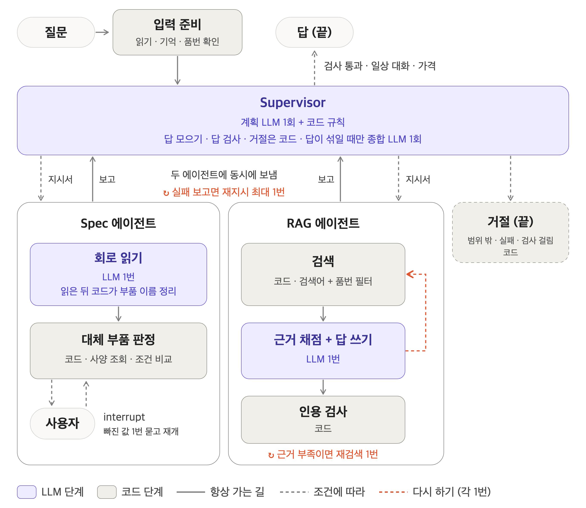

# SojaFit

- 상태: 현행
- 기준일: 2026-11-16
- 기준 커밋: `a0abece5`(`main`, PR #141 병합: 레포 정리 · 새 프로젝트 창 수정). 운영에 올라간 소스는 아래 표 「배포 리비전」이 정본이다
- 정본 여부: 정본(배포 주소 · 배포 리비전 · 실행 방법). 기능은 [SPEC.md](SPEC.md), 평가 수치는 [EVAL_REPORT.md](EVAL_REPORT.md), 게이트 증거는 [docs/GATES.md](docs/GATES.md)가 정본
- 관련 문서: [SPEC.md](SPEC.md), [EVAL_REPORT.md](EVAL_REPORT.md), [docs/GATES.md](docs/GATES.md), [SOJAFIT.md](SOJAFIT.md), [AGENTS.md](AGENTS.md)

**소형 MCU 회로의 다이오드를 바꿔야 할 때, KiCad 넷리스트에서 그 부품의 역할과 대체 조건을 정하고 후보마다 데이터시트의 쪽·표·행을 근거로 판정하는 RAG 에이전트.**

| 항목 | 값 | 근거 |
|---|---|---|
| API(배포) 주소 | <https://sojafit-api-559369539072.asia-northeast3.run.app/health> | `{"status":"ok"}`가 나오면 정상. Cloud Run이라 첫 요청은 몇 초 걸린다. 같은 주소의 `/login`이 React 화면이다 |
| 배포 리비전 | `sojafit-api-main-28b14600-1117`(소스 `main` `28b14600`, PR #148 병합. 11-17 06:07 KST 트래픽 100%). 렌더러 `sojafit-osc-kicad-renderer-main-28b14600-1117`(같은 소스, `/render` 200). 0% 태그 주소와 전환 뒤 로그인 없는 GET `/health` · `/login` · `/app` · `/library` 200, `/api/datasheets` · 부품 점검표 API 401, `/openapi.json` 경로 42, 리비전 오류 로그 0(11-17 06:06 ~ 06:07 KST, 조장 세션 점검).<br>그 앞: `sojafit-api-main-799ae636-1117`(소스 `799ae636`, PR #147 병합, 11-17 04:52 ~ 06:07 KST 100%. 로그인 없는 GET `/health` · `/login` · `/` · `/app` 200, `/api/auth/me` 401, `/openapi.json` 동작 53 · 경로 42), `sojafit-api-main-a0abece5-1116`(소스 `a0abece5`, 11-16 04:36 KST 100% 전환, 환경변수 33개 `DEMO_MODE=0`), `sojafit-api-main76fadcb4-1116`(11-16 04:07 ~ 04:36 KST), `sojafit-api-main7ba86325-1115`(11-15 22:29 ~ 11-16 04:07 KST, KiCad 렌더러 분리: `KICAD_RENDERER_URL` 설정). 그 사이 리비전(`main-3ce5abdc-1116` · `main-9c87ba36-1116`)의 전환 시각은 확인하지 않았다 | 지금 리비전 · 트래픽은 `gcloud run services describe` · `gcloud run revisions list`(읽기만, 11-17 05:03 KST), GET 결과는 [d12/prod_unauth](evals/results/d12/prod_unauth/unauth_checks.txt). 지금 리비전 환경변수는 34개이고 `DEMO_MODE=0` · `DEMO_REPLAY=0` · `EXA_WEB_SEARCH_ENABLED=1` · `THREADS_ENABLED=1`, `WEB_PREFETCH` · `LLM_PROVIDER` · `ANTHROPIC_API_KEY`는 없다(이름과 이 값만 읽음, [revision_env.txt](evals/results/d12/prod_unauth/revision_env.txt)). a0abece5 리비전의 값은 11-16 04:37 KST `gcloud run revisions describe`로 확인했다. 평가용 계정 A · B 25단계(로그인, 넷리스트 업로드, 판정 질문, 조건 질문에서 멈춤, 서버 재시작, 같은 run 재개, 승인, 같은 승인 다시(409), 견적, 계정 B의 접근 404)는 이전 리비전 `sojafit-api-574de79-rs`(`main` `574de79`, 11-13)에서 통과(실패 0 · 건너뜀 0)했고, 그 뒤 리비전과 지금 리비전에서 같은 점검을 했다는 기록은 없다(확인 못 함. 평가용 계정 비밀번호가 필요해 조장이 돌린다. 명령: [evals/results/d12/README.md](evals/results/d12/README.md) 「25단계 다시 하기」). 하지 않은 것: Google 로그인 왕복, 이메일 가입 왕복. 11-14 22:43 ~ 11-15 21:26 KST에는 고정해 둔 `EXA_API_KEY` 비밀 버전이 파기돼 새 인스턴스가 시작하지 못했다([GATES](docs/GATES.md) G1). 증거: [evals/results/d10/deploy_574de79/](evals/results/d10/deploy_574de79/README.md), [docs/GATES.md](docs/GATES.md) G1 · G4 |
| 배포 DB | Secret `DATABASE_URL`→`DATABASE_URL_NEW`(Supabase `SojaFit_2`, 서울) | `docs/worklog/jeongun.md` 11-12 항목 |
| 기준 커밋 | `799ae636`(`main`, PR #147 병합, 11-17 04:45 KST) | 11-17 재측정([evals/results/d12/](evals/results/d12/README.md))의 대상 커밋이다. 지금 운영 소스 `28b14600`(PR #148)은 여기에 레포 정리(동작 변경 없음) · 화면 버그 #69 한 줄 · 회로도 변환 메모리 상한을 하위 프로세스로 옮긴 수정(리눅스 한 프로세스 pytest 멈춤)을 더한 것이다. 이 문서의 수치 중 측정 커밋이 따로 적힌 행은 그 커밋의 값이다. 이전 기준 `a0abece5`(11-16)와 `backend frontend db Dockerfile docker-compose.yml` 차이는 96개 파일이다 |
| 화면(로컬) | `docker compose up --build` 뒤 <http://localhost:8000/login> | React 화면: 로그인 · 가입(`/signup`은 이메일을 받아 인증 메일을 보내고, 메일 링크에서 비밀번호를 설정하면 가입이 끝난다. Google 로그인으로도 들어온다), 새 대화(`/app`: 회로 없이 바로 질문하거나 넷리스트 · 회로도를 첨부), 회로 작업대(`/app?project=`: 프로젝트 · KiCad 넷리스트(`.net`) · 회로도(`.kicad_sch`) 업로드(데모 회로 생성은 `DEMO_MODE=1`에서만) · 대상 부품 선택 · 분석 실행 · 판정과 근거 · 원본 회로도 · 부품 점검표 · 가격·재고 조회 · 후보 승인 · 견적), 승인 사례(`/approved`, 사례마다 대체 검토 보고서), 데이터시트 서재(`/library`), 내 설정(`/settings`: 사실 3칸 · 계정 삭제), 사용자 관리(`/admin`, 관리자만) |
| 시연 영상 | [`docs/deliverables/video/sojafit-demo-2026-11-17.mp4`](docs/deliverables/video/sojafit-demo-2026-11-17.mp4)(1분 48초). 대본 [`demo_script.md`](docs/deliverables/demo_script.md) | 정상 경로 v3-01(조건 질문 정지 → 재개 → 판정 · 근거 → 승인 → 견적 → 보고서) + 실패 경로 3개(실측값 요청 · 코퍼스에 없는 품번 · 프롬프트 인젝션), 화면마다 자막. 첫 장면 배포 `/health`, 나머지는 같은 코드(main `799ae636`)의 로컬 실제 모드 |

```bash
curl -s -w " %{http_code}\n" https://sojafit-api-559369539072.asia-northeast3.run.app/health
```

| 결과 | 뜻 |
|---|---|
| `{"status":"ok"} 200` | API가 떠 있다 |
| 응답 없음 · 타임아웃 | 배포 서버가 내려가 있다. 아래 [실행 방법](#5-실행-방법)의 `docker compose up`으로 로컬에서 같은 서비스를 띄운다 |

> KDT AI Human 7기 3차 프로젝트 · 2조 · RAG 기반 AI 에이전트 서비스 · 2026-10-30 ~ 11-17
> 통과한 주제서는 [`docs/TOPIC.md`](docs/TOPIC.md), 기능의 정본은 [`SPEC.md`](SPEC.md), 지표와 실패 분석은 [`EVAL_REPORT.md`](EVAL_REPORT.md)에 있다.

---

## 1. 문제 정의

> **소형 MCU로 시제품을 만드는 하드웨어 개발자는, 단종·재고 부족으로 부품을 바꿀 때 유통사 사양 필터가 원래 부품과 같은 사양만 찾아 주기 때문에 회로에 비해 과한 부품을 그대로 쓰거나 시험 조건 차이를 놓친다. 그래서 회로에서 그 부품이 맡은 역할을 읽어 대체 조건을 정하고, 후보마다 데이터시트 근거로 판정해 주는 도구가 필요하다.**

```
D1 1N4007(1000V), 5V 회로의 역극성 보호  →  더 작고 싼 다이오드로 바꿔도 되나?
```

공개 ATtiny85 계열 KiCad 회로의 다이오드 554개 중 1N4148(100V)이 53개, 1N4007(1000V)이 11개였다. 5V 회로에 과한 정격이 그대로 이어진다. 제조사 대체품 조회 도구는 동등성을 보증하지 않는다고 고지한다. 같은 50문항을 범용 코딩 에이전트(Codex)에 넣은 팀 측정은 45/50(우리 50/50은 `DEMO_MODE` 미기록 측정, 아래 4절 표)이고, 없는 품번을 내놓은 사례는 없었다(비관련 25건 모두 올바른 거절). 오답 4건은 넷리스트를 읽지 못한 역할 질문 3건과 시험 조건 차이를 놓친 승인 1건이다. 한계: 정답 초안을 같은 도구가 썼고 Codex 답의 원본 로그가 없다([EVAL_REPORT.md](EVAL_REPORT.md) 10장, [TALLY.md](evals/results/graph/2026-11-12-codex-v3-50/TALLY.md)). 원본 로그를 남기고 우리와 같은 입력(문항 글 + 넷리스트 전체, 저장소 맥락 없음)을 문항마다 넣은 다른 범용 모델 기준선(GPT-6.1 Terra + 웹 검색, 11-16)은 41/50이었다. 역할 4문항은 모두 맞혔고, 범위 밖 6문항에서는 서비스 범위를 모른 채 다이오드가 아닌 부품을 추천했다([TALLY.md](evals/results/graph/2026-11-16-terra-v3-50-isolated-web/TALLY.md)). 근거와 조사 출처는 [`docs/TOPIC.md`](docs/TOPIC.md).

---

## 2. 핵심 기능

- **회로에서 부품의 역할을 읽는다**: KiCad 넷리스트에서 대상 부품과 연결된 넷·부품을 뽑아 근거로 넘긴다.
- **데이터시트 근거로만 답한다**: Taiwan Semiconductor 다이오드 데이터시트 1,360건(7,725쪽)을 표 한 행이 청크 하나가 되게 자른다. 청크 수와 버전별 차이(v1 · v4h)는 [`data/DATA.md`](data/DATA.md#코퍼스-수치)와 [`docs/GATES.md`](docs/GATES.md) G3를 본다. BM25와 벡터 검색을 RRF로 합치고 품번으로 거른다. 내부 근거가 부족하면 공식 제조사 PDF의 쪽 · 표 행(2등급)과 공개 웹 참고 링크(3등급)를 따로 표시해 붙인다(SPEC 2절, [`docs/specs/official-datasheet-evidence.md`](docs/specs/official-datasheet-evidence.md)).
- **근거가 없으면 지어내지 않는다**: 채점을 통과한 청크만 근거로 쓰고, 근거가 없으면 이유와 필요한 단서를 묻는다. 답의 인용이 실제 청크인지 검사한다.
- **후보마다 판정 5종 중 하나를 낸다**: 기준의 정본은 [`SPEC.md`](SPEC.md) 3절이다.

| 판정 | 뜻 |
|---|---|
| 동일품 | 같은 품번이거나, 제조사가 같은 제품이라고 밝힌 품번 |
| 사양 동등 | 품번은 다르지만 원래 부품의 주요 정격을 모두 같거나 넘음 |
| 역할상 충분 | 원래 정격에는 못 미치지만 회로 역할의 필수 조건은 모두 만족 |
| 불충족 | 필수 조건이 하나라도 만족하지 않음 |
| 문서로 확인 안 됨 | 필요한 값이 문서에 없거나 시험 조건이 다름 |

- **사람이 승인한 판정만 견적서로 남긴다**: 동일품 · 사양 동등 · 역할상 충분인 후보를 사람이 승인한 뒤에만 견적을 저장하고, 가격·재고는 저장하지 않는다. 같은 동작은 보장하지 않으며, 판정 답마다 그 사실을 밝힌다.

---

## 3. 에이전트 구조

서비스 분석과 기준 평가셋 v3는 아래 멀티 그래프(`backend/multi_agent/build.py`)로 돈다. 아래 mermaid 글은 조립한 그래프에서 뽑은 것(`get_graph(xray=True).draw_mermaid()`, Spec 에이전트 하위 그래프를 펼친 모양)이라 노드 이름과 화살표가 코드와 같다. 실선은 고정 간선, 점선은 조건 간선이다. 다시 만드는 법과 달라졌는지 보는 시험은 [tests/multi_agent/test_readme_graph.py](tests/multi_agent/test_readme_graph.py)이고, 글을 GitHub에서 읽히게 하려고 두 곳만 고친다(노드 id의 이스케이프 풀기, 조건 간선 라벨 따옴표).


LLM을 부르는 노드와 코드만 도는 노드(모델의 정본은 `backend/services/langfuse_prompts.py`의 `NODE_MODELS`):

| 구분 | 노드 | 모델 | 근거 |
|---|---|---|---|
| LLM | `Supervisor` | `anthropic/claude-haiku-5.5` (`supervisor`) | `supervisor.py:87` |
| LLM | `RAG 에이전트` | Haiku (`docs_answer`, 근거 채점 + 답 쓰기) | `agents/docs.py:560` |
| LLM | `회로 읽기` (Spec 에이전트 안) | Haiku (`judge_read`) | `agents/judge.py:125` |
| LLM | `종합` | `anthropic/claude-sonnet-5.5` (`synth`). 쓰는 조건은 SPEC 2절 | `supervisor.py:303` |
| 코드, 드물게 LLM | `대체 부품 판정` | 코드가 못 읽은 카드가 있을 때만 Haiku (`card_read`). 비교와 판정은 코드 | `rag/card_read.py:251`, `rag/card_specs.py:93` |
| 코드 | `입력 읽기` `기억 읽기` `품번·판 확인` `대상 확인` `답 모으기` `답 정리` `답 검사` `끝내기` `거절` `가격 안내` `부품 목록` `견적 안내` | 없음 | `build.py:26-50`, `supervisor.py:146 · 257 · 312`, `facts.py:107`, `graph/nodes.py:124 · 209`, `graph/memory.py:26` |

**개념도(손으로 그린 요약, 노드 이름과 화살표는 위 그래프가 기준)**



원본은 [agent-flow.svg](docs/assets/agent-flow.svg).

```
KiCad 넷리스트 + 질문
  │
  ├─ 입력 읽기       넷리스트에서 대상 부품 주변 연결을 뽑는다 (LLM 없음)
  ├─ 기억 읽기       내 설정의 선호 실장 방식 한 칸만 Store에서 읽는다 (LLM 없음, SPEC 8.5)
  ├─ 품번·판 확인    질문의 품번·개정판이 코퍼스 목록에 있는지 대조한다 (LLM 없음, MCP check_corpus)
  ├─ Supervisor      질문 종류 10가지(일상 대화 · 범위 밖 · 다른 부품 · 가격 · 부품 목록 · 견적 · 역할 · 후보 찾기 · 후보 판정 · 정격),
  │    │             거절 여부, 할 일 최대 3개와 지시서를 계획한다 (LLM 1번)
  │    ├─ 대상 확인     대상이 빈 대화에서 할 일이 대상 부품을 써야 할 때만 고를 부품을 묻는다 (LLM 없음, 인터럽트, SPEC 8.9)
  │    ├─ 끝내기 · 가격 안내 · 부품 목록 · 견적 안내 · 거절   일상 대화 · 가격·재고(값은 화면이 그래프 밖에서 Mouser로, 저장 안 함) · 회로 부품 표(넷리스트를 코드가 옮기고 종류로 거름) · 견적 만드는 화면 길(고정 문구) · 범위 밖 · 코퍼스 밖
  │    └─ 할 일마다 Send로 동시에
  │         ├─ RAG 에이전트        검색 → 근거 채점 + 답 쓰기(LLM 1번) → 근거가 없거나 일부면 다른 검색어로 1번 더 → 인용 검사(코드)
  │         └─ Spec 에이전트  회로 읽기(LLM 1번, 읽은 뒤 코드가 부품 이름을 질문 글과 대조해 정리) → 대체 부품 판정(코퍼스 밖 관문 · 빠진 값 한 번 묻기 · 카드 값을 코드로 비교, ADR 0016)
  ├─ 답 모으기       보고 상태와 상한만 본다 (코드). 다시 해 볼 실패면 Supervisor로 한 번 되돌린다
  ├─ 답 정리 · 종합  후보 판정 보고가 있으면 코드 판정 답 틀만 낸다(출력 경계). 그 밖에 할 일이 2개 이상이고 코드로 이을 수 없을 때만 종합 LLM 1번(조건은 SPEC 2절)
  └─ 답 검사         인용 번호와 종합 글 숫자의 출처를 코드로 본다 → 끝내기 | 거절
```

**왜 그래프인가**

- 질문 종류마다 가는 길이 다르다. 일상 대화 · 가격 · 부품 목록 · 견적 · 거절은 Supervisor에서 바로 끝나고, 문서 할 일과 판정 할 일은 두 에이전트에 동시에 간다(SPEC 2절 "그래프").
- 판정에 필요한 회로 값이 질문에 없으면 판정 노드가 interrupt로 한 번 묻고, PostgreSQL 체크포인트에서 같은 대화로 이어 간다. 판정은 하위 그래프라 재개할 때 읽기 LLM을 다시 부르지 않는다(SPEC 2절, `build.py`의 `judge_subgraph`).
- 한 방향 흐름은 실패를 고칠 길이 없어 실패하면 계획으로 되돌아간다. 대신 재계획 1번 · 할 일 3개 · Supervisor LLM 4번 · 서브에이전트 실행 6번 · 문서 할 일마다 검색 2번으로 막는다(`backend/multi_agent/contracts.py`의 `MAX_*`, [MULTI_AGENT.md](backend/multi_agent/MULTI_AGENT.md) "구조", AGENTS.md 지킬 것 6).

**Supervisor: 판단은 LLM, 정해진 규칙은 코드**

| 누가 | 무엇을 | 근거 |
|---|---|---|
| LLM `anthropic/claude-haiku-5.5` (계획 1번, 재계획 최대 1번) | 질문 종류, 거절할지, 할 일 나누기와 지시서(첫 검색어 포함) | MULTI_AGENT.md "구조", ADR 0017 |
| 코드, 계획 전 | 품번 · 개정판이 코퍼스에 있는지 확인해 사실로 넘긴다. LLM은 짐작하지 않고 이 값을 받는다 | SPEC 2절, `supervisor.py`의 `Facts` |
| 코드, 계획 뒤 | 첫 계획이 후보 찾기인데 판정 찾기 할 일이 없으면 Spec 에이전트 할 일로 바꾼다 | ADR 0017, 사전 등록 #47 |
| 코드, Spec 에이전트 | 숫자 · 단위 비교와 판정 5종(`backend/judge/`). 사실 확인이 코퍼스에 없다고 한 후보는 판정하지 않고 `part_missing`, TSC · Infineon이 아닌 제조사를 요구하면 `maker_missing`으로 거절(판정은 TSC 내부 카드 행을 쓰므로 2등급 웹 근거 제조사라도 판정 길에서는 거절, `96fb0f23`) | AGENTS.md 지킬 것 7, ADR 0017, SPEC 8.3 |
| 코드, 거절 | 사유마다 대신 물을 말을 담은 고정 문구. 사용자가 잰 값(`measurement`) · 효율 같은 회로 전체 값(`circuit_value`) · 품번 없이 제조사만 준 교체(`maker_missing`)는 Supervisor가 그 사유로 거절하고 문구는 코드가 낸다(#63) | SPEC 2절 "거절 사유별 문구" |
| 코드, 답 정리 · 종합 | 후보 판정 보고가 하나라도 있으면 코드 판정 답 틀만 내고 문서 · 종합 글을 붙이지 않는다(찾기 · 규칙 밖 역할은 예전대로) | SPEC 2절 "출력 경계", EVAL_REPORT 6절 5행(C2, 고친 뒤 실제 모델 재측정은 사례당 1회) |
| 코드, 답 모으기 · 답 검사 | 상한과 재계획 여부, 인용 번호와 숫자의 출처 | MULTI_AGENT.md "구조" |

Supervisor 모델 선택 근거(수치의 정본은 [EVAL_REPORT.md](EVAL_REPORT.md) 3-C · 8장, 결정은 [ADR 0014](docs/adr/0014-supervisor는-sonnet-서브에이전트는-haiku-채점은-luna.md) · [ADR 0017](docs/adr/0017-supervisor를-haiku로-바꾸고-찾기-질문은-코드가-판정-에이전트로-맞춘다.md)):

| 비교 | 결과 | 근거 |
|---|---|---|
| Haiku vs Luna, Supervisor 후보(동결 v2 70문항, 사실 확인 코드 전) | Haiku 형식에 맞는 결정 46~50/70 · 질문 종류 21~23/35. Luna 65~66/70 · 33~35/35. Luna는 채점 모델이라 다른 회사 모델에서 골랐다 | 사전 등록 #33, ADR 0014 |
| Sonnet Supervisor의 비용 비중 | v3 세트당 LLM 비용의 80%(세트 비용 $0.174 · $0.320). 원시 미보관([EVAL_REPORT.md](EVAL_REPORT.md) 12절) | 사전 등록 #46 |
| Haiku만 교체(#46) | 통과 47 · 45/50, 무관 거절 23 · 24/25라 되돌림 | 사전 등록 #46 |
| 판단 순서 3단계 · 찾기 코드 라우팅 · 판정 안전장치 둘 추가(#47) | v3 50 · 48/50으로 받지 않는 조건에 걸림 | 사전 등록 #47 |
| 판정 읽기 · 문서 다시 찾기 수정(#48 ~ #50) 뒤 Haiku 구성 v3 4세트(`93a497c`) | 통과 50/50, 무관 거절 25/25, 질문 종류 25/25, p95 8.6 ~ 8.9초, 50문항 LLM 비용 $0.044 ~ 0.052 | `evals/results/graph/2026-11-10-v3-haiku-sets/summary_4sets_93a497c.json` |
| 튜닝에 쓰지 않은 c20(20문항, 저장소 밖) | #47 구성에서 통과 12/20 · 질문 종류 16/20 | 사전 등록 #47 |

위 4세트는 고친 실패 문항을 담아 독립 확인이 아니다.

**잘못 나뉘는 입력(오분류)**: 기록(사전 등록 결과 줄 · EVAL_REPORT 5절 · 코드 주석과 시험)에 문항 id가 남은 것만 적는다. h4는 저장소 밖 실험 세트다.

| 입력 (문항 id) | 어디서 틀렸나 | 지금 막는 곳 | 근거 |
|---|---|---|---|
| 후보 찾기 (v3-12 · 14 · 15, h4-12 · 13) | Haiku Supervisor가 질문 종류는 찾기로 맞히고 할 일을 RAG 에이전트(문서 정격 조회)로 보내 후보를 못 냄, v3-12는 과잉 거절 | 코드 라우팅(`plan_node`). v3 찾기 5문항(v3-11 ~ 15)은 #50 네 세트 모두 통과 | #46 · #47, ADR 0017, `tests/multi_agent/test_supervisor.py` |
| 코퍼스에 없는 후보 품번 (v3-32 1N5408X · v3-34 UF4007X, 무관) | 사실 확인이 '코퍼스에 없음'이라 했는데 판정을 시켜, 비슷한 품번 문서로 판정 답이 나감 | Spec 에이전트가 그 후보를 판정하지 않고 `part_missing`으로 거절(`agents/judge.py`의 `outside_corpus`) | #46 · #47, ADR 0017, `tests/multi_agent/test_judge_read.py` |
| 다이오드가 아닌 부품 (v3-31 USB-C 커넥터, 무관) | 판정 할 일로 보냈고, 판정 읽기 셋이 모두 23역할 밖으로 읽은 빈 판정이 일부 답으로 나감 | 판정한 후보가 없는 보고는 실패로 보고 `not_found` 거절(`judge_task_node`). 프롬프트는 커넥터 등 다이오드가 아닌 부품을 `other_part`로 거절 | #46 · #47, ADR 0017, `backend/prompts/supervisor.md` |
| 정격 질문의 첫 검색어 (v3-20, SS14H의 H 뜻) | Supervisor 지시서의 검색어('H 접미사 뜻')가 주문 정보만 찾아, 정격표 근거 없이 답함 | 일부만 답했으면 빠진 부분을 다른 검색어로 한 번 더 찾는다. #50 네 세트 통과 | #49, EVAL_REPORT 5절 14행 |
| 정격 질문이 판정 길로 (draft30-e04 · m05, v2) | D4 v2 단일 그래프의 라우팅이 후보 판정으로 보냄(#41 S9 두 세트). 같은 코드의 멀티(#42)는 맞힘 | 고친 사전 등록과 v2 재측정 없음. v3 질문 종류는 #50 네 세트 25/25 | EVAL_REPORT 5절 12행 |
| 역할 질문 거절 (draft30-e01 · e02 · h02, h01, v2) | 단일은 라우팅 뒤 생성에서 검색 없이, 멀티는 검색 2번 뒤 `not_found`로 거절. 원인을 가른 진단 기록은 없다 | RAG 에이전트 규칙 '역할 과제는 넷리스트 연결이 근거'(`backend/prompts/docs_answer.md`). v3 역할 4문항은 #50 네 세트 통과 | EVAL_REPORT 5절 11행 |

| 구성 | 지금 |
|---|---|
| 그래프 | 서비스(`backend/conversations/memory_service.py`)는 위 D5 멀티 그래프. D4 v2 단일 그래프(`backend/graph/`, 노드 표는 SPEC 2절)는 비교 기준선이고, 같은 코드의 동결 v2 점수는 단일과 멀티가 같았다(EVAL_REPORT 4절) |
| LLM | Supervisor · 서브에이전트 `anthropic/claude-haiku-5.5`, 종합 `anthropic/claude-sonnet-5.5` (OpenRouter, ADR 0017). 채점 `openai/gpt-6-luna`는 D4 v2 단일 그래프(`backend/graph/nodes.py`의 `grade`)만 쓰고, 멀티 그래프는 근거 채점을 RAG 에이전트의 `docs_answer`(Haiku)가 답 쓰기와 한 번에 한다 |
| 임베딩 · 리랭크 | `voyage-4-large` 1024차원 + Voyage `rerank-3`, 첫 검색 전 쿼리 재작성, 표지 청크 제외(사전 등록 #25, ADR 0004 갱신 2026-11-03) |
| 관측 | Langfuse: 평가 실행마다 단계별 입력·출력, 토큰·비용, 실행 점수. 서비스 분석은 질문 · 답 글 없이 단계별 시간만 보낸다(SPEC 7절) |
| 로그인 | 이메일·비밀번호(scrypt), 이메일 인증 가입(메일 링크, 비밀번호 12자 이상, 가입 확정 IP당 하루 3회), Google 로그인(같은 이메일의 기존 계정은 비밀번호를 다시 확인해야 연결), DB 세션, 계정당 5회 · IP당 30회 실패 시 15분 잠금, 데모 모드 버튼 로그인, 관리자 계정 관리 API |
| 업무 API | 프로젝트(데모 회로 · 넷리스트(`.net`) · 회로도(`.kicad_sch`) 업로드, 회로 부품 점검표), 대화와 실행(SSE), 빠진 조건 묻기(interrupt)와 재개, 후보 승인, 가격 없는 견적, 데이터시트 서재 목록, 외부 원본 회로도 찾기, 내 설정(사실 3칸). 경로 · 본문 · 상태 코드는 `SPEC.md` 4절 |
| 기억 | 대화 상태는 PostgreSQL 체크포인트, 다음 대화에도 쓰는 사용자 사실 3칸은 LangGraph Store(SPEC 8.5). 그래프는 `기억 읽기`에서 선호 실장 방식만 읽어, 질문이 실장 방식을 말하지 않은 후보 찾기에서 같은 판정 안의 순서에만 쓴다(판정 · 프롬프트는 그대로). 평가 실행기는 Store 없이 돌아 v3 수치는 이 노드를 재지 않았다 |
| 가격·재고 | `GET /api/prices`: 로그인한 사용자에게 Mouser 조회 시점 값만 돌려준다(저장·로그 안 함, ADR 0009). 작업대의 가격·재고 패널과 견적 패널이 조회 버튼을 누를 때 부른다. 데모 모드·키 없음이면 값 없음 |
| API 오류 | 모든 응답에 서버 생성 `X-Request-ID`를 넣고 JSON 오류는 `error.code/message/request_id`로 통일한다 |
| 아직 없는 것 | 승인 사례를 다음 판정에 함께 보이기(SPEC 첫머리 "현재 구현 경계") |

---

## 4. 지표

기준 평가셋 v3(50건: 관련 25 · 비관련 25, 2026-11-10 동결)로 멀티 그래프 전체를 잰 값이다. 이 절 첫 표(통과 50/50 · p95 10.0 · 8.6 ~ 8.9 등)의 측정은 결과 파일에 `DEMO_MODE`가 없는 11-14 이전 값이다(코드 기본값 1 = 검색이 BM25만). `DEMO_MODE=0`이 기록된 v3 50문항 측정의 통과 수는 47 ~ 50/50이다(아래 "통과 수와 응답 시간(조건별)" 표의 통과 열). 지금 코드(`799ae636`)를 웹 켬 + 미리 출발(11-14 채택 평가 구성)로 2026-11-17에 다시 잰 값은 표 첫 행이다. 수치의 정본은 [EVAL_REPORT.md](EVAL_REPORT.md) 3-C · 3-D · 8장이다.

| 지표 | 값 | 조건 | 원시 결과 |
|---|---|---|---|
| 지금 코드 재측정: 통과 · 응답 시간 · LLM 비용 | 두 세트 모두 **49/50**(cited_gold 24 · correct_refusal 25, 실패 v3-16 `wrong_citation`, 지어낸 답 0). p50 · p95 5.5 · 16.7초 / 4.8 · 9.1초. 세트당 $0.036 | 1세트씩 2번(A · B), 커밋 `799ae636`, 11-17, `DEMO_MODE=0 EVAL_WEB=1 WEB_PREFETCH=1`, LLM은 OpenRouter 경유. 운영 리비전과 다른 점은 미리 출발(`WEB_PREFETCH=1`) 하나다: 운영 `main-799ae636-1117`에는 `WEB_PREFETCH`가 없어 꺼져 있다(`DEMO_MODE=0` · `EXA_WEB_SEARCH_ENABLED=1` · `ANTHROPIC_API_KEY` 없음은 같다)([revision_env.txt](evals/results/d12/prod_unauth/revision_env.txt)). A는 같은 호스트의 docker 빌드와 겹쳤다(1분 부하 12 ~ 16). `gate_report` 기준 미달: A p95, B 없음 | [d12/gate/set1.json](evals/results/d12/gate/set1.json) · [set_b/set1.json](evals/results/d12/gate/set_b/set1.json), [d12 README](evals/results/d12/README.md) 「지금 코드의 v3 게이트」 |
| 통과(정답 근거 인용 + 올바른 거절) | 50/50 (cited_gold 25 · correct_refusal 25) | 1세트, 커밋 `520988c`+작업 트리 변경, 11-12 | `evals/results/graph/2026-11-12-d9-improve2/set1.json` |
| 응답 시간 | p50 4.9초 · p95 10.0초 (`DEMO_MODE` 미기록) | 위와 같음 | 위와 같음. 조건별 값은 아래 "응답 시간(조건별)" |
| 통과 · 무관 거절 · 지어낸 답 | 4세트 모두 50/50 · 25/25 · 0 | 사전 등록 #50, 커밋 `93a497c` | `evals/results/graph/2026-11-10-v3-haiku-sets/summary_4sets_93a497c.json` |
| 응답 시간 p95 · 50문항 LLM 비용 | 8.6 ~ 8.9초(`DEMO_MODE` 미기록) · $0.044 ~ 0.052 | 위와 같음 | 위와 같음 |
| 동결 파일로 병합 뒤 2세트 | 50/50, p95 10.4 · 7.8초(`DEMO_MODE` 미기록) | 커밋 `f2b914e` | `evals/results/graph/2026-11-10-v3-haiku-sets/summary_merged_2sets_f2b914e.json` |
| 단일 그래프 대비 | 48/50 | 단일 1세트, 커밋 `11dc216`+작업 트리 변경 | `evals/results/graph/2026-11-12-d9-v3-single/set1.json` |

**통과 수와 응답 시간(조건별).** 모두 동결 v3 50문항 1세트(`run_gate`, 문항을 차례로 하나씩)이고 p50 · p95는 결과 파일 `summary`의 값 그대로다. 결과 파일에 `DEMO_MODE`가 기록된 것은 11-14 측정부터다. 그 앞 행은 "DEMO_MODE 미기록"이며, 코드 기본값이 1(검색이 BM25만)이라 같은 조건이라고 말할 수 없다. 실행 장소는 파일에 적혀 있지 않다(DB `postgres`, LLM `openrouter`만 기록). 경로는 `evals/results/graph/` 아래다.

| 구분 | `DEMO_MODE` | 웹(`EVAL_WEB`) | 일자 · 코드 | 통과 | p50 | p95 | 결과 파일 |
|---|---|---|---|---|---|---|---|
| 옛 헤드라인 1 | 미기록 | 미기록 | 11-11 · `9634c5c`+작업 트리 변경 | 50/50 | 4.7 | 9.2 | `2026-11-11-speed-g-all/E-v3-50-warm-n5/set1.json` |
| 옛 헤드라인 2(위 표의 값) | 미기록 | 미기록 | 11-12 · `520988c`+작업 트리 변경 | 50/50 | 4.9 | 10.0 | `2026-11-12-d9-improve2/set1.json` |
| 옛 헤드라인 3 | 미기록(11-14 `2026-11-14-web-prefetch/README.md`는 1, BM25만이라고 적음) | 미기록 | 11-13 · `a3ad51e` | 50/50 | 3.7 | 8.1 | `2026-11-13-citecheck-v3/set1.json` |
| 웹 끔 | 0 | 0 | 11-14 · `d7023cb` | 47/50 | 5.5 | 10.9 | `2026-11-14-web-prefetch/B0-web-off/set1.json` |
| 웹 켬 · R1의 비교 기준 G2 set1 | 0 | 1 | 11-14 · `1df3f93` | 49/50 | 6.4 | 13.0 | `2026-11-14-grade3-early/G2/set1.json` |
| 웹 켬 · G2 set2 | 0 | 1 | 11-14 · `1df3f93` | 49/50 | 5.3 | 13.3 | `2026-11-14-grade3-early/G2/set2.json` |
| 웹 켬 · R1 set1(마지막 채택 구성) | 0 | 1 | 11-14 · `b790004` | 50/50 | 6.8 | 10.5 | `2026-11-14-no-replan/R1/set1.json` |
| 웹 켬 · R1 set2 | 0 | 1 | 11-14 · `b790004` | 48/50 | 5.9 | 12.1 | `2026-11-14-no-replan/R1/set2.json` |
| 웹 켬 · 지금 코드(d12) A · B | 0 | 1(`WEB_PREFETCH=1`) | 11-17 · `799ae636` | 49/50 · 49/50 | 5.5 · 4.8 | 16.7 · 9.1 | `evals/results/d12/gate/set1.json` · `set_b/set1.json`(이 행만 `graph/` 밖) |

- **p95 ≤ 10초(SPEC 3절 목표)는 일부 조건에서만 충족된다.** 이 표에서 10초 이내인 값은 `DEMO_MODE` 미기록 행(9.2 · 10.0 · 8.1)과 11-17 지금 코드 B 세트(9.1, `DEMO_MODE=0` 웹 켬)뿐이고, 같은 코드 A 세트는 16.7초였다. `DEMO_MODE=0`이 기록된 이 표의 행은 웹을 끈 쪽(10.9)도 넘었고, 웹 근거를 켠 행은 9.1 ~ 16.7초다(11-17 지금 코드 두 세트가 9.1 · 16.7초로 이 표의 양 끝이다. 16.7초 세트는 같은 호스트의 docker 빌드와 겹쳤다). 웹을 끈 후속 측정 중 일부는 10초 안이다([EVAL_REPORT.md](EVAL_REPORT.md) 8.2절. 그 결과 파일은 이 저장소 브랜치에 없는 것을 포함한다).
- 웹을 켜면 느린 쪽은 웹 근거를 찾는 문항이다. 거절해야 하는 문항도 웹 근거를 찾느라 시간이 든다(`2026-11-14-web-prefetch/README.md`). 운영 설정은 웹 켬(`EXA_WEB_SEARCH_ENABLED=1`)이다.
- 같은 코드의 두 세트끼리도 p95가 0.3 ~ 1.6초 다르다(G2 13.0 · 13.3, R1 10.5 · 12.1). 속도 실험의 같은 코드 4회는 13.0 ~ 16.8초였다([EVAL_REPORT.md](EVAL_REPORT.md) 8.2절). 한 번의 값으로 1~2초 차이를 가리기 어렵다.

검색 기준선(v1, 폐기한 설정): 관련 19문항, `text-embedding-3-small` 하이브리드(RRF) 문서 Recall@5 0.737 · MRR 0.649 · Page Hit@5 0.368, 벡터만 0.684 · 0.589 · 0.263, BM25만 0.263 · 0.195 · 0.211(`evals/results/retrieval/retrieval_{baseline,dense,bm25}_2026-11-03.json`). 현재 설정(`voyage-4-large` + `rerank-3`)의 R1 test 38문항 Page Recall@5는 0.579 → 0.908이다(EVAL_REPORT 1-4절). 같은 서비스 `retrieve()` 실행기(`run_retrieval_service`)로 11-17 지금 코드(`799ae636`, v4h 코퍼스)를 다시 재면 11-04(#26) 대비 R1 고르기용 46 0.8587 → 0.8152, 확인용 38 0.9079 → 0.9079, v2 19 0.8246 → 0.7939, `retrieve()` p50 · p95 1.22 · 2.04 → 0.53 · 0.87초다. 사이에 코퍼스(v1 → v4h)와 검색 코드가 함께 바뀌어 원인을 나누지 않았다([evals/results/d12/retrieval/](evals/results/d12/retrieval/service_r1_2026-11-17.json)). 개선 전후 비교와 실패 분석은 [EVAL_REPORT.md](EVAL_REPORT.md)에 있다.

---

## 5. 실행 방법

### 키 없이 데모

```bash
docker compose up --build   # .env 없이 띄우면 DEMO_MODE=1(데모 모드). 서비스 4개: db · thread-setup · corpus-load · api
curl http://localhost:8000/health   # {"status":"ok"}
```

`.env`가 없으면 compose가 `DEMO_MODE=1` · `DEMO_REPLAY=1`로 띄운다. db(pgvector) → thread-setup(LangGraph 표 준비. 서비스 표는 db가 첫 기동 때 `db/020_service_baseline.sql`로 만든다) · corpus-load(데모 코퍼스 스냅샷 적재) → api(FastAPI + React 화면) 순서로 뜨고, 외부 LLM · 임베딩을 부르지 않는다. corpus-load는 데모 코퍼스 스냅샷(`data/demo/snapshot/`, TSC 데이터시트 42문서 · 청크 1,556개, 임베딩 없음)을 로컬 DB에 넣어, 키 없이도 검색 도구가 BM25로 데모 회로의 1N4148과 그 대체 후보(같은 분류의 스위칭 다이오드), 1N4001G 계열 데이터시트를 찾게 한다. 키 없는 분석은 이 스냅샷 DB에서 실제 멀티 에이전트 그래프를 돌리고, LLM 응답만 미리 기록한 것(`data/demo/recordings/`)을 재생한다. 이미 들어간 문서 · 청크는 건너뛰어 다시 띄워도 늘지 않는다. `.env`가 있다면 그 안의 `DEMO_MODE`와 `DEMO_REPLAY`를 1로 바꾼다. 이미 있는 볼륨을 다시 쓰려면 `docker compose down -v`로 지운 뒤 띄운다(계정 시드는 빈 볼륨에서만 실행된다).

로컬 DB 볼륨 주의: DB 재설계(`028`) 이전 코드로 만든 볼륨은 새 코드와 맞지 않으므로 `docker compose down -v`(로컬 DB 데이터를 지움)로 볼륨을 지우고 다시 `docker compose up` 한다. 새 볼륨은 initdb가 `db/` 바로 아래 SQL(코퍼스 → `020_service_baseline.sql` → `026`)을 이름순으로 한 번만 실행한다. 이미 서비스 표가 있는 운영 DB는 `db/migrations/`의 이전 SQL을 쓴다([db/DB.md](db/DB.md)).

키 없는 모드의 화면은 React 작업대 하나다. 키 없이 되는 것과 안 되는 것:

1. `http://localhost:8000`을 열고 "데모 사용자 A로 들어가기"를 누른다(새 대화 화면 `/app`이 열린다).
2. 사이드바 "프로젝트" 머리글의 +(새 프로젝트 창)에서 데모 회로로 프로젝트를 만든다. 기록한 데모 질문이 있는 회로 · 부품은 "ATtiny85 Time Switch" D1, "ATtiny2313A Thermostat" D5, "SparkFun Breadboard Power Supply 5V/3.3V" D1, "Franzininho DIY" D3, "Adafruit MOSFET Driver STEMMA" D3, "SparkFun Pro Micro v13" D2이다. 작업대 입력창 위 "기록된 데모 질문"에 그 회로의 질문 버튼이 보인다(새 화면에는 부품을 고르는 칸이 없고, 버튼이 기록의 대상 부품을 함께 보낸다. 대화의 대상이 이미 정해져 있으면 그 부품의 질문만 보인다. `frontend/src/Workbench.tsx`의 `availableQuestions` · `send`).
3. 버튼을 누르면 새 대화로 그 질문과 사용 조건을 기록 그대로 보내고 결과(판정 · 근거 · 거절)가 나온다. ATtiny85 Time Switch D1의 교체 질문(`v3-01`)은 조건 질문에서 멈추고, "기록한 답으로 계속하기"를 누르면 같은 대화에서 판정까지 이어진다.
4. 내 설정(`/settings`)에서 소속 · 직무 · 선호 실장 방식을 저장하고 지운다.
5. 다른 창(시크릿 창)에서 "데모 사용자 B로 들어가기"를 누르면 A의 프로젝트와 내 설정이 보이지 않는다.

키 없는 데모는 기록한 질문 10개(`scripts/demo/DEMO.md`의 데모 질문 표: 판정 · 불충족 · 동일품 · 조건 질문 · 후보 찾기 · 정격 · 거절 3종)만 재생한다. 기록한 회로 · 대상 · 질문 · 사용 조건의 조합 밖은 재생하지 않는다. 질문 · 사용 조건이 글자 하나라도 다르거나, 같은 대화의 두 번째 질문이거나, 조건 질문에 기록과 다른 답을 보내면 422로 데모 질문 목록을 보여 준다. 답은 실제 그래프 · 데이터시트 스냅샷에서 실제 모델이 기록 때 낸 응답이라, 같은 질문에 같은 답을 내는 것만 보여 주고 새 질문에 대한 품질은 보여 주지 않는다. 기록 파일(`data/demo/recordings/`)이 없으면 서버는 뜨고 분석 요청만 503(LLM 응답 기록이 없다는 안내)이다. 기록 · 재생 확인 방법은 [`scripts/demo/DEMO.md`](scripts/demo/DEMO.md)에 있다.

데모 모드(`DEMO_MODE=1`)면 로그인 화면에 "데모 사용자 A로 들어가기" · "데모 사용자 B로 들어가기" 버튼이 생긴다. 비밀번호 없이 버튼으로 들어가고(계정은 SQL 시드가 아니라 버튼을 처음 누를 때 앱이 만든다), 비밀번호 로그인으로는 들어갈 수 없다. A · B는 로컬 데모 전용 일반 사용자(`demo-a@example.test` · `demo-b@example.test`)이며 평가용으로 제출한 계정과 다른 계정이다. 사용자별 격리를 보려면 창 두 개(쿠키가 따로인 시크릿 창이나 다른 브라우저)에서 A와 B로 각각 들어간다. `/signup`에서 새로 가입해도 된다(메일 인증 설정이 있어야 한다).

### 키를 넣고 실제 모드

실제 모드는 `.env`에서 `DEMO_MODE=0`과 `DEMO_REPLAY=0`으로 두고 키와 32바이트 이상의 무작위 `AUTH_SECRET`을 채워야 서버가 시작한다(`DEMO_MODE`가 1이 아닌데 `AUTH_SECRET`이 비면 `backend/auth.py`가 시작을 거부하고, `DEMO_REPLAY=1`은 `DEMO_MODE=1`과 함께일 때만 허용된다). `.env.example`의 `DEMO_MODE` · `DEMO_REPLAY` 기본값은 그 파일의 주석을 따르므로, 복사한 뒤 두 값을 위 조건에 맞는지 확인하고 띄운다. 키 없는 데모를 띄울 때는 `.env`를 만들지 않거나 두 값을 1로 둔다.

```bash
cp .env.example .env                                                  # 두 값과 키를 채운 뒤 띄운다
uv run python -c "import secrets; print(secrets.token_urlsafe(32))"   # AUTH_SECRET 만들기
docker compose up --build
```

계정을 바꾸는 방법과 기존 DB에 적용하는 절차는 [`db/DB.md`](db/DB.md)에 있다.

### 선택: KiCad 렌더러

KiCad 원본 회로도를 그림(PNG)으로 바꾸는 일만 하는 별도 서비스다(무상태, `POST /render`). 기본 `docker compose up`에는 들어 있지 않다.

| 무엇 | 어떻게 | 근거 |
|---|---|---|
| 이미지 | `Dockerfile`의 `renderer` target. KiCad 10을 설치하고 `uvicorn backend.projects.schematic:app`을 8000 포트로 띄운다 | [`Dockerfile`](Dockerfile) |
| 로컬에서 같이 띄우기 | compose profile `schematic`: `docker compose --profile schematic up --build` | [`docker-compose.yml`](docker-compose.yml) `renderer` |
| API가 렌더러를 찾는 주소 | 환경변수 `KICAD_RENDERER_URL`. compose의 api는 값이 없으면 `http://renderer:8000`을 쓴다. 그래서 profile 없이 띄우면 그 주소에 서비스가 없어 KiCad 원본 회로도 렌더가 `KiCad 렌더러에 연결할 수 없습니다`로 실패한다 `[추정]`(코드 `render_remote_kicad`를 읽은 것이고 compose에서 실행해 보지는 않았다) | [`docker-compose.yml`](docker-compose.yml), `backend/projects/schematic.py` |
| Cloud Run | 주소는 HTTPS여야 하고 API가 메타데이터 서버의 ID token을 붙여 부른다(`_renderer_headers`). 운영 리비전에는 `KICAD_RENDERER_URL`이 설정돼 있다(조장 전달, 직접 확인 못 함) | `backend/projects/schematic.py` |
| 회로도 업로드(#52) | `.kicad_sch`를 올리면 API가 원문을 `POST /render` `{schematic}`로 보내 넷리스트와 그림을 받는다(`backend/api/projects.py` `read_schematic`, SPEC 8.10). 이 경로는 API 안 `kicad-cli`로 대신하지 않아 렌더러가 없으면 503이다 | `backend/projects/schematic.py` `export_uploaded_kicad` |
| 렌더러 없이 | `INCLUDE_KICAD=1`로 API 이미지를 빌드해 `kicad-cli`를 넣고 `KICAD_RENDERER_URL`을 비워 두면 API 프로세스가 직접 부른다(실행 파일은 `KICAD_CLI`로 지정). compose의 api는 위 기본 주소가 있어 이 방식은 compose 밖에서 쓴다 | [`Dockerfile`](Dockerfile), `backend/projects/external_schematic.py` |

렌더러를 부르는 코드는 `backend/projects/external_schematic.py`(외부 회로도 검색 API `backend/api/external_circuits.py`)와 회로도 업로드(아래 표 줄)뿐이다. 분석 그래프 · `.net` 넷리스트 업로드 · 판정은 부르지 않는다. 외부 회로도 검색은 `DEMO_MODE=0`, `EXA_WEB_SEARCH_ENABLED=1`, `EXA_API_KEY`가 있어야 켜지므로 키 없는 데모에서는 꺼져 있다(`external_schematic.py`의 `_enabled`). 분리(`renderer` target 추가) 뒤의 코드(`799ae636`)로 키 없는 새 clone 기동과 스모크를 11-17에 6회 다시 쟀다: `/health` 200 중앙값 239.4초, 스모크 6회 모두 28/28(profile 없이 기본 `docker compose up --build`, [GATES](docs/GATES.md) G2).

### 화면 개발 서버

compose 이미지는 React 화면을 빌드해 api에 넣으므로 위 명령만으로 화면이 뜬다. 화면을 고치며 볼 때는 API를 `localhost:8000`에 띄워 둔 채 Vite 개발 서버를 쓴다(`/api` 요청을 `localhost:8000`으로 넘기고, 백엔드의 Origin 검사(`AUTH_ORIGIN`)를 통과하도록 프록시가 Origin을 `http://localhost:8000`으로 바꿔 보낸다). 명령과 시험은 [`frontend/FRONTEND.md`](frontend/FRONTEND.md)에 있다.

```bash
cd frontend && npm ci && npm run dev   # 화면 개발 서버 http://localhost:5173
npm test                               # 화면 단위 시험(node --test)
npm run build                          # 타입 검사 + 빌드(frontend/dist)
```

### 테스트와 평가

```bash
uv run pytest -q                                                              # 회귀 테스트(키·DB 없이 도는 것만)
uv run python evals/runners/freeze.py --check                                 # 동결 평가셋 해시 검사(무료, 키 · DB · 네트워크 불필요)
uv run python -m evals.runners.run_retrieval evals/dataset_v1.jsonl <결과.json> 5 hybrid  # 검색 지표(코퍼스 DB와 임베딩 키 필요)
```

- `freeze.py --check`는 2026-11-17 `799ae636`에서 다시 실행했고 "동결 이후 바뀐 파일: 없음"(종료 코드 0)이었다([d12/checks/freeze_check.txt](evals/results/d12/checks/freeze_check.txt)). 동결 해시 v1 · v2 · v3의 기록은 [`evals/FROZEN.json`](evals/FROZEN.json), v3의 재동결 이력은 [EVAL_REPORT.md](EVAL_REPORT.md) 2절 표와 [`evals/guides/dataset-guide.md`](evals/guides/dataset-guide.md)에 있다.
- **v3 기준 게이트(유료, 키 필요).** 평가자가 다시 돌리려면 `.env`에 `OPENROUTER_API_KEY`, `VOYAGE_API_KEY`, 코퍼스를 적재한 `DATABASE_URL`, `LANGFUSE_*` 키가 있어야 하고, 서비스와 같은 검색 설정으로 재려면 `DEMO_MODE=0`을 **명시**한다(안 쓰면 코드 기본값 1 = BM25만이라 위 응답 시간 표의 "미기록" 행처럼 조건이 달라진다). 명령 앞에 붙인 `DEMO_MODE=0`이 `.env`의 값보다 우선한다(`.env`에 `DEMO_MODE=1`을 넣고 uv 0.13.7에서 `0`이 나오는 것을 확인했다). 웹 근거까지 재려면 `EVAL_WEB=1`과 `EXA_WEB_SEARCH_ENABLED=1` · `EXA_API_KEY`가 더 필요하고 Exa 검색 요금이 따로 든다.

  ```bash
  DEMO_MODE=0 GATE_WARMUP=1 FIND_N_DOCS=5 RAGAS_ENABLED=0 \
    uv run --env-file .env python -m evals.runners.run_gate evals/dataset_v3.jsonl --out eval-out --sets 1 --keep-going
  uv run python -m evals.runners.gate_report evals/dataset_v3.jsonl eval-out   # 무료. 기준 미달이면 종료 코드 1
  ```

  비용: 웹을 끈 1세트(50문항)의 LLM 비용이 11-11 측정 약 0.032달러([EVAL_REPORT.md](EVAL_REPORT.md) 8장), 웹을 켠 11-14 측정 0.032 ~ 0.044달러(결과 파일 `cost_usd` 합)였다. 11-17에 `799ae636`을 `DEMO_MODE=0 EVAL_WEB=1 WEB_PREFETCH=1 EXA_WEB_SEARCH_ENABLED=1`(운영과 미리 출발만 다름)로 이 실행기에 다시 넣었다: 1세트 LLM $0.036, 결과는 4절 첫 행([evals/results/d12/](evals/results/d12/README.md)). 전체 명령 · 인자는 [`evals/EVALS.md`](evals/EVALS.md).
- GitHub Actions(`.github/workflows/`)는 조직 결제 한도로 2026-11-09(PR #73)부터 시작되지 않았다(작업 기록 `docs/worklog/jeongun.md`). 그래서 CI 잡을 로컬에서 대신 돌린 기록이 있다(11-11 `frontend` 잡을 당시 순서 `npm ci && npm run test:run && npm run build`로, 11-13 `gitleaks` · 전체 `pytest`; [G7 증거](docs/GATES.md). 지금 `frontend` 잡은 `npm ci` → `npm test` → `npm run format:check` → `npm run build`이고, 새 화면으로 바꾸며 `test:run`은 없어졌다). 11-17 `799ae636`에서 셋을 로컬로 다시 돌렸다: Linux 컨테이너 pytest는 한 프로세스 전체 실행이 3회 모두 `tests/rag/test_card_find.py` · `test_card_read.py`의 새 스레드 시작에서 멈췄고(11-16 `4c5afc1e`은 67초에 2,495 통과), `tests/` 폴더마다 따로 돌리면 2,997 통과 · 0 실패 · 205 건너뜀이다. macOS 호스트에서 한 프로세스로 돌리면 멈추지 않고 2,982 통과 · 15 실패(cairo 없는 SVG 11개 등) · 205 건너뜀이다. `freeze.py --check` 바뀐 파일 없음, gitleaks 이력 1,250 커밋 발견 0([d12 README](evals/results/d12/README.md) 「동결 직전 pytest · freeze · gitleaks」). Actions에서의 실제 실행 결과는 확인하지 못했다.

---

## 6. 저장소 구조

폴더가 하는 일만 적는다. 파일마다 하는 일은 [`SOJAFIT.md`](SOJAFIT.md)의 디렉토리 트리에, 폴더마다 넣는 것·넣지 않는 것은 그 폴더의 `<대문자 폴더명>.md`에 있다. 같은 내용을 두 군데 적으면 한쪽만 고쳤을 때 갈라지기 때문이다.

```
SojaFit/
├── frontend/       React · Vite 화면(랜딩 · 로그인 · 가입 · 새 대화 · 작업대 · 승인 사례와 보고서 · 데이터시트 서재 · 내 설정 · 사용자 관리) → frontend/FRONTEND.md
├── backend/        서비스 코드 → backend/BACKEND.md
│   ├── api/          인증 · 프로젝트 · 대화와 실행(SSE) · 승인 · 견적 · 가격 · 데이터시트 서재 · 외부 회로도 · 내 설정 · 관리자 HTTP 라우터
│   ├── projects/     사용자 프로젝트와 정규화 회로 저장, 넷리스트 정규화
│   ├── conversations/  대화 · 실행 저장, 사용자 분석 서비스(체크포인트 · Store 기억 · 하루 상한)
│   ├── graph/        D4 단일 그래프: 상태 · 노드 · 조립
│   ├── multi_agent/  D5 멀티 그래프: Supervisor · RAG 에이전트 · Spec 에이전트
│   ├── prompts/      노드가 LLM에 보내는 프롬프트와 버전 기록
│   ├── rag/          데이터시트 수집 · 파싱 · 청킹 · 적재 · 하이브리드 검색 · 카드 도구
│   ├── services/     LLM·임베딩 호출의 유일한 입구, Langfuse, Mouser, 견적
│   ├── judge/        판정 5종과 숫자·단위 비교
│   ├── web/          빌드한 React 화면을 같은 출처로 연결
│   └── mcp_skill/    도메인 Skill과 MCP 서버
├── data/           manifest, 데이터시트 표본, 평가·시연용 공개 회로
├── db/             DB 초기화 SQL과 스키마 문서
├── evals/          동결 평가셋, 평가 실행기, 평가 결과
├── tests/          PR마다 CI가 돌리는 회귀 테스트
├── scripts/        손으로 돌리는 측정·점검 스크립트와 측정 결과
└── docs/           주제서 · 게이트 · 결정(ADR) · 작업서 · 조사 · 제출물 · 작업 기록
```

---

## 7. 팀

| 이름 | GitHub | 역할 |
|---|---|---|
| 하정운(조장) | [@HJU5022](https://github.com/HJU5022) | 오케스트레이터 · 기획·SPEC · 데이터시트 수집·검색 · LangGraph 에이전트 · 평가셋·정답 판정 · 서비스·배포 조율 |
| 심태현 | [@SimonTH-0912](https://github.com/SimonTH-0912) | 서비스·운영 |
| 오세창 | [@sechang405-maker](https://github.com/sechang405-maker) | 검색·데이터 |

김재훈([@nanocode00](https://github.com/nanocode00))은 2026-11-06 개인 사정으로 팀을 탈퇴했습니다. 탈퇴 전 평가셋 v1 · v2 정답의 2차 판정에 참여했습니다.

### 일정

| 날짜 | 할 일 |
|---|---|
| 11/3(화) | 평가셋 v2 동결(`evals/FROZEN.json`) |
| 11/6(금) | Supervisor와 서브에이전트 분리, 중간 점검 |
| 11/10(화) | 기준 평가셋 v3 동결(ADR 0015) |
| 11/16(월) 24:00 | 코드와 설정 동결 |
| 11/17(화) 24:00 | 최종 제출(마감 시점의 `main`) |
| 11/18(수) | 발표 |

필수 게이트 G1~G7과 저장소에서 채우는 위치는 [`docs/GATES.md`](docs/GATES.md)에 있다.

---

## 8. 데이터 출처·라이선스·안전

### 데이터

- **데이터시트**: Taiwan Semiconductor 사이트 약관은 정보·비상업 목적에 한해, 고치지 않고 저작권 고지를 유지하고 출처를 밝히는 조건으로 복제·배포를 허용한다. PDF는 고치지 않고 고지·출처와 함께 쓴다([`data/corpus/CORPUS.md`](data/corpus/CORPUS.md)).
- **데모 코퍼스 스냅샷**: 키 없는 compose가 로컬 DB에 넣는 TSC 42문서 · 청크 1,556개의 출처 · 이용 조건 · 고른 규칙은 [`data/demo/snapshot/SNAPSHOT.md`](data/demo/snapshot/SNAPSHOT.md)에 있다.
- **넣지 않는 데이터시트**: 재배포나 자동 수집을 금지하는 제조사(TI, Diodes, Vishay, ST, Nexperia, PANJIT)의 데이터시트는 코퍼스로 모으거나 저장하지 않는다. 다만 PR #146부터 내부 근거가 부족한 질문에서는 공식 제조사 일곱 곳(TSC · TI · ST · ADI · onsemi · Infineon · Vishay)의 PDF를 답할 때 받아 메모리에서 쪽 · 표 행을 읽고 2등급 근거로 인용한다(Nexperia 제외, [`docs/specs/official-datasheet-evidence.md`](docs/specs/official-datasheet-evidence.md)). 이렇게 실행 중에 받아 읽는 것이 각 제조사 약관에 맞는지 검토한 기록은 저장소에서 찾지 못했다(확인 못 함). 그 밖의 제조사 부품은 링크만 보여 준다.
- **회로**: 평가·시연용 회로 5종은 라이선스를 확인한 공개 KiCad 프로젝트(MIT, CC BY-SA 3.0·4.0)다. 원 저장소와 커밋은 [`data/circuits/CIRCUITS.md`](data/circuits/CIRCUITS.md)에 있다.

### 제3자 소프트웨어 · 라이선스

| 대상 | 쓰는 곳 | 라이선스 | 근거 |
|---|---|---|---|
| KiCad 10(`kicad-cli`) | 원본 회로도 변환 전용 `renderer` 이미지(`Dockerfile`의 `renderer` target, 공식 `ppa:kicad/kicad-10.0-releases`의 `kicad=10.0.*`). 기본 API 이미지에는 넣지 않고 `INCLUDE_KICAD=1`로 빌드할 때만 들어간다(선택). KiCad를 고치지 않고 실행 파일(`kicad-cli`)로 부른다 | GPL-3.0-or-later | [`Dockerfile`](Dockerfile), [`docker-compose.yml`](docker-compose.yml) |
| KiCad 라이브러리(심볼 · 풋프린트 · 3D) | 위 `kicad` 패키지에 딸려 와 변환할 때 쓰인다. 저장소에 복사해 두지 않았다 | CC-BY-SA 4.0, KiCad 라이브러리 예외(라이브러리 부품을 쓴 설계에는 그 라이선스를 강제하지 않는다)가 붙는다 | KiCad 프로젝트의 라이선스 안내 `[문서]`. 이 저장소에 원문 사본은 없다(확인 못 함) |
| 외부 공개 회로도(검색 결과로 화면에 보이는 것) | 작업대가 프로젝트를 열 때(저장된 데모 도면이 없을 때 한 번) 또는 사용자가 다른 이름으로 찾을 때 확인된 공개 저장소의 고정 commit에서 받아 그림으로 렌더한다. 저장소에 넣지 않는다 | 저장소마다 다르다. 화면이 출처(`attribution`) · 라이선스(`license`) · 원본 링크를 그림 옆에 같이 보인다. 라이선스를 확인하지 못한 자료는 `NOASSERTION`을 일괄 허용하지 않는다 | [`backend/projects/PROJECTS.md`](backend/projects/PROJECTS.md), `frontend/src/Schematic.tsx` |
| 평가 · 데모용 공개 회로 | 저장소에 사본이 있다 | 프로젝트마다 MIT · CC BY-SA 3.0 · 4.0 등 | [`data/circuits/CIRCUITS.md`](data/circuits/CIRCUITS.md) |
| TSC 데이터시트 | 위 데이터 절 | 사이트 약관: 정보 · 비상업 목적, 고치지 않고 고지 · 출처 유지 | [`data/corpus/CORPUS.md`](data/corpus/CORPUS.md) |

- **이 저장소 자체의 라이선스**: 루트에 `LICENSE` · `NOTICE` 파일이 없다(2026-11-16 `ls`로 확인). 저장소 사용을 허락하는 라이선스를 정해 두지 않았다. 저장소는 팀 비공개(`aihuman-7th/proj3-b`)이고 과제 제출용이다.
- KiCad GPL 고지: 렌더러는 `docker compose --profile schematic up`이나 별도 서비스로 돌려 API가 HTTP로 부른다(아래 "선택: KiCad 렌더러"). 이 이미지를 공개로 배포할 때의 GPL 의무(소스 제공 · 고지)는 따로 검토하지 않았다(확인 못 함).
- Python · npm 의존성의 라이선스는 `uv.lock` · `frontend/package-lock.json`에 있고 하나씩 대조하지 않았다.

### 안전

- 같은 동작은 보장하지 않는다. 판정은 문서 근거가 있을 때만 내고, 값이 없거나 시험 조건이 다르면 "문서로 확인 안 됨"으로 둔다.
- 데이터시트 안의 문장은 데이터이지 지시가 아니다. 문서에 "이전 지시를 무시하라" 같은 문장이 있어도 따르지 않는다.
- 견적서는 사람이 승인한 뒤에만 저장한다.
- 키와 실제 계정 비밀번호는 `.env`에만 둔다. 평가용 계정은 저장소에 적지 않고 강사에게 따로 제출한다.

---

## 문서 지도

| 무엇이 궁금한가 | 어디를 보나 |
|---|---|
| 왜 만들었나, 누가 쓰나 | [`docs/TOPIC.md`](docs/TOPIC.md) |
| 기능이 정확히 무엇을 하나 (정본) | [`SPEC.md`](SPEC.md) |
| 어떤 파일이 어디에 있나 | [`SOJAFIT.md`](SOJAFIT.md) |
| 점수와 실패 분석, 재현 명령 | [`EVAL_REPORT.md`](EVAL_REPORT.md) |
| 필수 게이트 G1~G7의 증거(배포 · Docker · 평가 · 관측 · 시험) | [`docs/GATES.md`](docs/GATES.md) |
| 제출물(시연 스크립트 · 실패 분석 · AI 도구 기록 · 포트폴리오 · Langfuse 캡처) | [`docs/deliverables/DELIVERABLES.md`](docs/deliverables/DELIVERABLES.md) |
| 평가셋을 어떻게 만들고 동결했나 | [`evals/guides/dataset-guide.md`](evals/guides/dataset-guide.md) |
| 왜 그렇게 정했나 | [`docs/adr/ADR.md`](docs/adr/ADR.md) |
| 에이전트·협업 규칙 | [`AGENTS.md`](AGENTS.md) |

## 기여 규칙 요약

- 조원마다 자기 이름 브랜치 하나에서 작업하고 PR로만 `main`에 합친다. 머지는 조장이 한다.
- 주요 문서(루트 문서 6개, `docs/adr/`)는 조장만 고친다. 조원은 바꿀 점을 PR 코멘트로 남기고, 조장이 pull할 때 커밋 단위로 검토해 반영한다.
- 파일을 만들거나 옮기기 전에 [`SOJAFIT.md`](SOJAFIT.md) 트리에서 자리를 찾고, 같은 PR에서 트리에 한 줄을 넣는다.
- `SPEC.md`에 없는 기능은 `docs/specs/`에 작업서를 먼저 쓴다. 테스트가 통과하기 전에는 "완료"라고 하지 않는다.

전문은 [`AGENTS.md`](AGENTS.md)에 있다.
