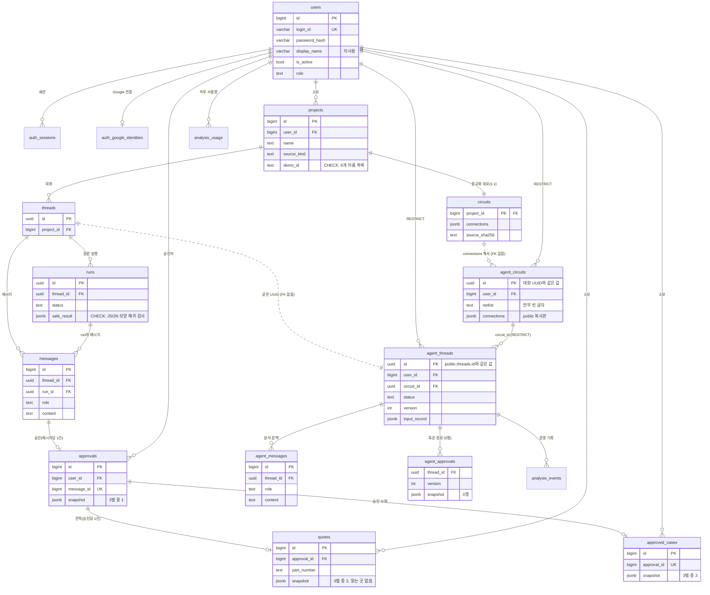
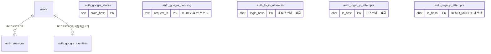

# 현재(as-is) ERD

- 기준: 운영 DB 구조(11-10 밤). 표 정의서: [`tables.md`](tables.md).
- **실선(`||--o{`)은 DB의 FK**, **점선(`||..||`)은 FK가 없고 같은 UUID로만 논리적으로 묶인 관계**다.
- 범위 밖(그림에서 뺀 것): 코퍼스 4표(`source_documents` → `document_chunks` → `chunk_embeddings` · `chunk_embedding_bits`), LangGraph 체크포인트 표(`sojafit_agent.checkpoints` · `checkpoint_blobs` · `checkpoint_writes`, `thread_id`가 text라 FK 없음).

## 1. 전체 그림

> 그림의 `agent_*`는 `sojafit_agent.*` 스키마의 표다(mermaid 이름 규칙 때문에 접두로 줄였다).

## 2. 인증 표 (그림 1에서 뺀 것)

앞의 네 표(`auth_google_states` · `auth_google_pending` · `auth_login_attempts` · `auth_login_ip_attempts` · `auth_signup_attempts`)는 `users`와 FK가 없다(해시 키로만 식별, 사용자가 없어도 쌓이는 방어 장치).

## 3. 읽는 법: 지금 구조의 핵심 문제 4개

| 번호 | 그림에서 보이는 것 | 의미 |
|---|---|---|
| ① | 점선 2개(`threads`↔`agent_threads`, `circuits`↔`agent_circuits`) | 같은 대화 · 회로가 두 스키마에 있고 DB가 연결을 보장하지 않음 |
| ② | `snapshot`이 `approvals` · `quotes` · `approved_cases`에 | 같은 JSON이 3벌 |
| ③ | `agent_approvals`(0행)와 `auth_google_pending` | 부르는 코드가 없는 표 |
| ④ | `agent_*`의 FK가 `RESTRICT` | 계정 · 프로젝트 삭제는 코드가 분석 기록을 먼저 지워야 하고, DB는 그 순서를 강제하지 못함 |
