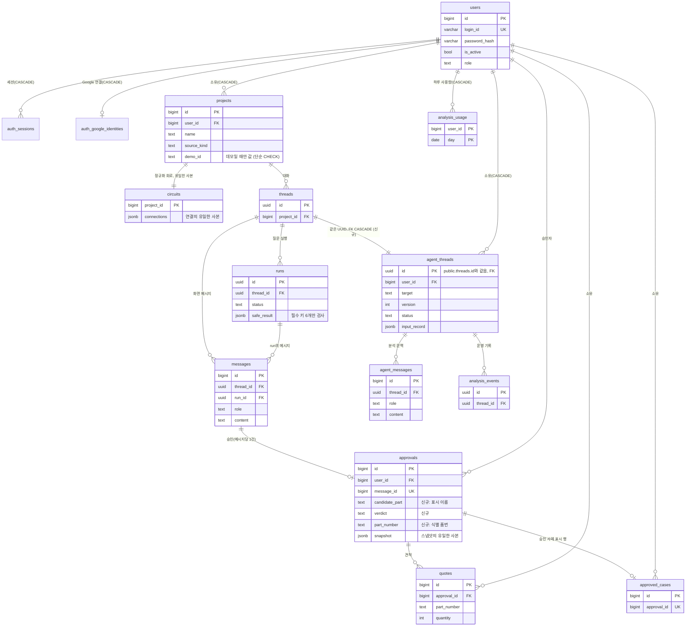
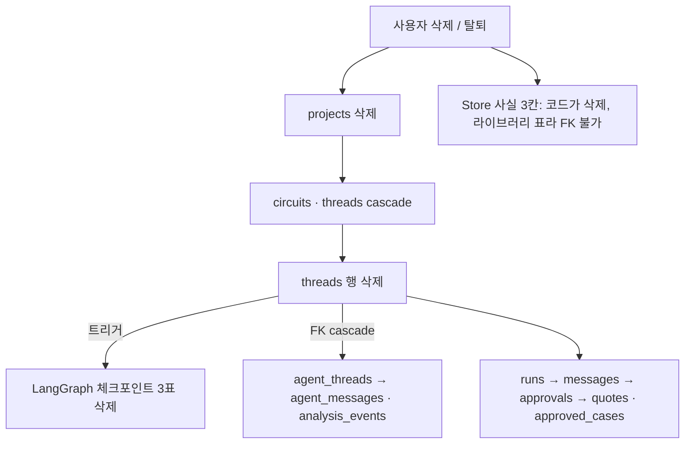
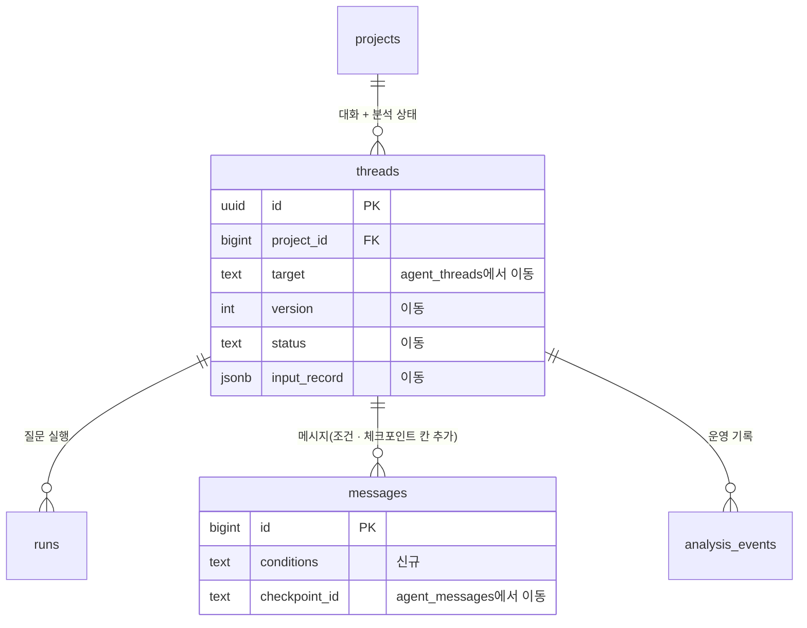

# 목표(to-be) ERD

- 기준: [`baseline_service.sql`](sql/baseline_service.sql). 표 정의서는 [`tables.md`](tables.md), 현재 구조는 [`../as-is/erd.md`](../as-is/erd.md).
- **모든 선이 DB의 FK다.** 현재 구조의 점선(같은 UUID로만 묶임)이 사라졌고, `sojafit_agent.*`의 FK는 전부 `CASCADE`다.
- `agent_*`는 `sojafit_agent.*` 스키마의 표를 그림 이름 규칙 때문에 줄여 쓴 것이다.

## 1. 추천안(P1 + P2): 서비스 표 전체

### 그림에 없는 것
- 인증 보조 표(`auth_login_attempts` · `auth_login_ip_attempts` · `auth_signup_attempts` · `auth_google_states`)와 `analysis_service_usage` · `app_migrations`는 다른 표와 FK가 없다(해시 키 · 날짜 키로만 식별).
- **LangGraph 체크포인트 3표**(`sojafit_agent.checkpoints` · `checkpoint_blobs` · `checkpoint_writes`)는 `thread_id`가 글자라 FK를 걸 수 없다. 대신 **`public.threads`의 BEFORE DELETE 트리거**(`trg_threads_purge_checkpoints`)가 대화 행이 지워질 때 같이 지운다. 프로젝트 · 계정 삭제의 cascade, 보관 기간 청소, 운영자의 직접 삭제 어느 경로든 같다.
- 사라진 표: `sojafit_agent.circuits`(분석 회로 사본), `sojafit_agent.approvals`(죽은 승인 경로), `public.auth_google_pending`(승인 대기, 선택 단계 2b).

## 2. 삭제의 흐름(목표)

## 3. 보류안(P3): 이중 구조를 끝까지 합친 모양 — 지금은 하지 않는다

`sojafit_agent.threads` · `messages`를 `public`으로 합쳐 분석 서비스에 "대화 상태" 표가 하나만 남는 모양이다. 효과는 가장 크지만 분석 서비스 전체(`memory_service.py` 약 15개 함수)와 시험 60여 개를 다시 써야 하고, 분석 입력 문자열이 조금이라도 달라지면 키 없는 데모의 기록 재생이 깨진다([`impact.md`](impact.md) 4절). 추천안(그림 1)은 이 합치기의 **전제(FK, 단일 회로 사본)**까지만 만든다.
