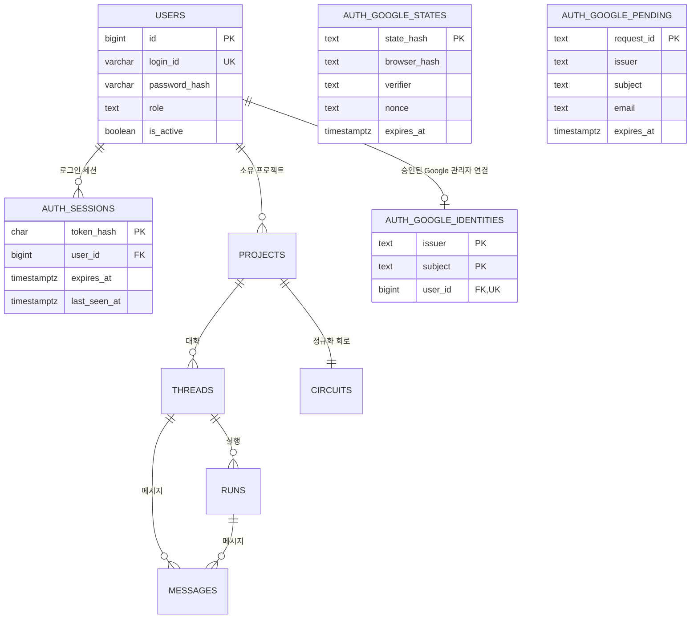

# DB ERD

## 기본 규칙

- 표를 만들거나 바꾸는 SQL PR에서 이 문서도 같이 고칩니다.
- 열의 정본은 SQL입니다. 여기에는 표마다 하는 일 한 줄과 만드는 곳만 적습니다.
- 우리가 만드는 표와 라이브러리가 만드는 표를 나눠 적습니다.

## 그림

- `auth_google_states`는 브라우저에 묶인 10분짜리 일회성 로그인 상태이며 사용자 표와 직접 연결하지 않습니다.
- `auth_google_pending`은 Google이 확인한 계정을 운영자가 검토하기 전의 임시 요청입니다. 승인 전에는 `users`와 FK를 만들거나 세션을 발급하지 않습니다.
- 승인하면 `auth_google_identities.user_id`가 기존 관리자 `users.id`를 1:1로 참조합니다. `(issuer, subject)`가 복합 기본키입니다.
- ID·PW 로그인과 승인된 Google 로그인은 모두 같은 `users`와 `auth_sessions`를 사용합니다. Google access token·refresh token·ID token은 저장하지 않습니다.

## 우리가 만드는 표

| 표 | 하는 일 | 만드는 SQL |
|---|---|---|
| `source_documents` | 코퍼스 문서(데이터시트)의 출처·개정판·해시·파서 | `002_rag_corpus.sql` |
| `document_chunks` | 검색 청크의 본문·쪽·표 이름·행 | `002_rag_corpus.sql` |
| `chunk_embeddings` | `002`가 만든 `vector(1536)`을 `008`이 차원 없는 `halfvec`으로 전환해 과거 1536차원 행과 현재 Voyage 1024차원 행을 함께 저장. HNSW 없음, 정확 검색 | `002_rag_corpus.sql`, `008_multi_dim_embeddings.sql` |
| `chunk_embedding_bits` | voyage-4-large 임베딩의 1비트 코드 `BIT(1024)`, 인덱스 없음(dense 1단계 Hamming 후보) | `009_chunk_embedding_bits.sql` |
| `users` | 로그인 사용자와 관리자·일반 사용자 역할 | `003_auth.sql`, `006_user_roles.sql` |
| `projects` | 사용자 소유 회로 프로젝트·출처·이름·시각. 소유자별 목록 인덱스 | `013_projects.sql` |
| `circuits` | 프로젝트 1:1 정규화 연결 JSON·출처 hash·파서 버전. 프로젝트 삭제 cascade, PK가 FK 인덱스를 겸함 | `013_projects.sql` |
| `auth_sessions` | 사용자 세션 해시와 만료 시각 | `003_auth.sql` |
| `auth_login_attempts` | 로그인 시도 제한 | `003_auth.sql`, `005_auth_attempt_window.sql` |
| `auth_google_states` | state·브라우저 비밀·PKCE verifier·nonce를 보관하는 10분짜리 일회성 Google 로그인 상태 | `010_google_auth.sql` |
| `auth_google_pending` | 검증된 Google 이메일·issuer·subject의 관리자 연결 승인 대기 요청 | `010_google_auth.sql` |
| `auth_google_identities` | 승인된 Google 계정과 기존 관리자 사용자 계정의 1:1 연결 | `010_google_auth.sql` |
| (정할 것) | 승인된 견적서 등 업무 표 | `manual/004_create_business_tables.sql.draft`(Migration 1 초안) 검토 뒤 |

문서·청크 표는 코퍼스 SQL, 사용자·세션 표는 기존 인증 SQL, Google 관리자 연결 표는 `010_google_auth.sql`이 생성합니다. `docs/worklog/sth.md`에는 격리 DB 검증과 팀 Supabase 적용이 기록돼 있으며, 이 ERD 병합 작업에서는 공유 DB를 다시 조회하지 않았습니다. Migration 1 초안(`manual/004_create_business_tables.sql.draft`)은 이 표들을 참조합니다.

## 라이브러리가 만드는 표

`langgraph-checkpoint-postgres` 3.2.0의 `setup()`이 만듭니다. 우리 SQL에서 만들지 않습니다.

| 표 | 만드는 곳 | 하는 일 |
|---|---|---|
| `checkpoints` | `PostgresSaver` | thread별 그래프 상태(체크포인트) |
| `checkpoint_blobs` | `PostgresSaver` | 체크포인트의 채널 값 |
| `checkpoint_writes` | `PostgresSaver` | 재개할 때 쓰는 노드의 중간 쓰기 |
| `checkpoint_migrations` | `PostgresSaver` | 체크포인트 스키마 버전 |
| `store` | `PostgresStore` | 사용자별 장기 기억. namespace는 `("memories", user_id)`(`backend/graph/memory.py`) |
| `store_vectors` | `PostgresStore` | 기억의 임베딩(인덱스를 설정할 때) |
| `store_migrations`, `vector_migrations` | `PostgresStore` | Store 스키마 버전 |

`db/014_conversations.sql`은 프로젝트 소유 대화·실행·메시지를 만든다. 체크포인트 표는 LangGraph 설치 경로로 별도 생성한다.
