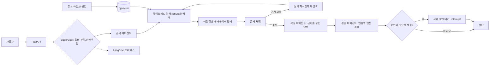

# 아키텍처

조의 설계를 그림과 글로 남기는 자리입니다. 발표와 `EVAL_REPORT.md`가 이 문서를 가리킵니다. 아래는 출발점이고, 조의 구조에 맞게 고치세요.

## 요청 흐름 (출발점)

## 조가 채울 것

| 질문 | 답 |
|---|---|
| 왜 그래프인가(분기, 반복, 승인이 왜 필요한가) | |
| Supervisor와 서브에이전트는 각각 무엇을 책임지고, 무엇을 서로 모르게 하는가(컨텍스트 격리) | |
| 어디서 사람 승인(interrupt)을 받는가, 왜 거기인가 | |
| 체크포인트에서 무엇이 저장되고 어떻게 재개되는가 | |
| 로그인한 사용자 id가 thread와 Store namespace에 어떻게 들어가는가 | |
| 무엇을 State에 두고 무엇을 Store에 두는가 | |
| 벡터DB는 무엇이고 왜 골랐는가(선택 이유와 한계) | |
| 신뢰 경계: 코퍼스 안의 지시문(간접 인젝션)은 어디서 막는가 | |

## 결정 기록

바꿀 때마다 한 줄씩 남깁니다. `날짜 | 무엇을 | 왜 | 대안`
