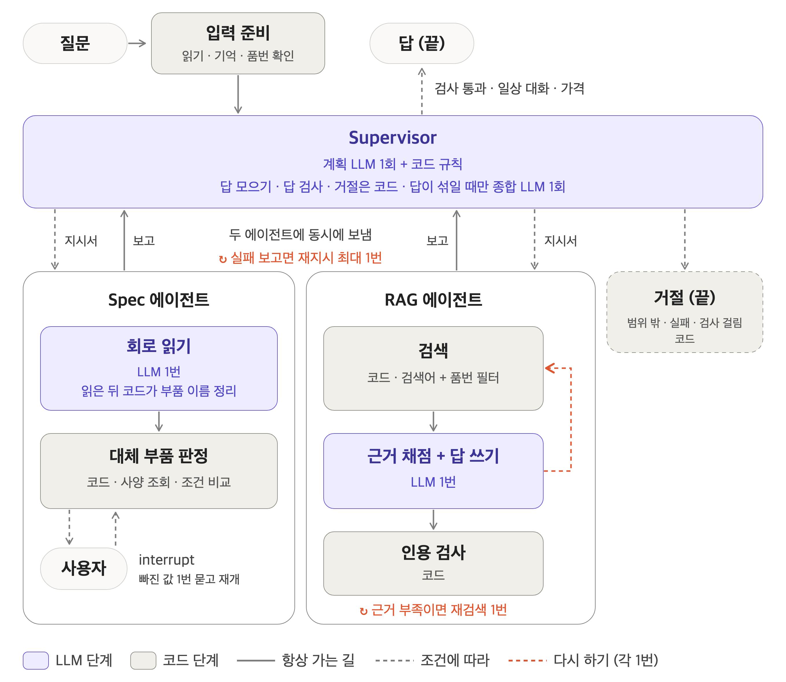

# 아키텍처와 조원 계약서

- 상태: 현행
- 기준일: 2026-11-12
- 기준 커밋: 6707002
- 정본 여부: 비정본. 구조의 정본은 [SPEC.md](../../SPEC.md) 2절 "그래프"와 [MULTI_AGENT.md](../../backend/multi_agent/MULTI_AGENT.md), 담당·규칙의 정본은 [AGENTS.md](../../AGENTS.md)와 [README.md](../../README.md) 7절. 이 문서는 설계 질문 8개의 답과 정본 위치를 모은다
- 관련 문서: [REFERENCE.md](REFERENCE.md), [SOJAFIT.md](../../SOJAFIT.md), [ADR](../adr/ADR.md)

발표와 [EVAL_REPORT.md](../../EVAL_REPORT.md)가 이 문서를 가리킨다.

## 1. 구조

현재 구조는 Supervisor 1개와 서브에이전트 2개(RAG 에이전트, Spec 에이전트)의 계획형 멀티 그래프다. 노드와 흐름은 [README.md](../../README.md) 3절의 그림 [agent-flow.png](../assets/agent-flow.png)(원본 [agent-flow.svg](../assets/agent-flow.svg))과 [SPEC.md](../../SPEC.md) 2절이 정본이다.

## 2. 설계 질문 8개

| 질문 | 답 | 근거 |
|---|---|---|
| 왜 그래프인가(분기, 반복, 승인) | 질문 종류마다 가는 길이 다르다: 일상 대화·가격·거절은 Supervisor에서 바로 끝나고, 문서 할 일과 판정 할 일은 두 에이전트에 동시에 간다. 판정에 필요한 회로 값이 질문에 없으면 판정 노드가 interrupt로 한 번 묻고 PostgreSQL 체크포인트에서 같은 대화로 이어 간다. 한 방향 흐름은 실패를 고칠 길이 없어 실패하면 계획으로 되돌아가되 재계획 1번, 할 일 3개, Supervisor LLM 4번, 서브에이전트 실행 6번, 문서 할 일마다 검색 2번으로 막는다 | README 3절 "왜 그래프인가", `backend/multi_agent/contracts.py` `MAX_*`, AGENTS.md 지킬 것 6 |
| Supervisor와 서브에이전트의 책임, 서로 모르게 하는 것(컨텍스트 격리) | Supervisor(Haiku, LLM 1번)는 범위 판정, 질문 종류, 할 일 최대 3개와 지시서(맡을 에이전트, 목표, 출력, 경계, 첫 검색어)를 정한다. 서브에이전트는 메모장 전체가 아니라 지시서와 필요한 입력만 받는다. RAG 에이전트는 검색, 근거 채점+답 쓰기, 인용 검사, Spec 에이전트는 회로 읽기, 코퍼스 밖 요구 관문, 빠진 값 묻기, 조건별 비교(코드)를 맡는다. 숫자·단위 비교는 `backend/judge/`만 한다 | `backend/multi_agent/MULTI_AGENT.md` "구조 결정", AGENTS.md 지킬 것 7 |
| 사람 승인(interrupt)은 어디서, 왜 거기인가 | 두 곳이다. (1) 판정에 필요한 회로 값이 빠졌을 때 Spec 에이전트의 판정 노드가 문항당 1번 묻는다(체크포인터가 있어야 켠다). (2) 견적 저장 전 사람 승인은 그래프 interrupt가 아니라 API 단계다(`POST /api/messages/{id}/approvals` 뒤에만 견적 저장). 판정 하위 그래프는 재개할 때 읽기 LLM을 다시 부르지 않는다 | SPEC.md 2절 "사람 확인", 4절, 8.4 |
| 체크포인트에는 무엇이 저장되고 어떻게 재개되는가 | 이번 대화의 상태는 `sojafit_agent` 스키마의 LangGraph 체크포인트에 저장된다. 체크포인트 표 3개는 `thread_id`(글자)로만 묶인다. 재개는 같은 thread의 같은 대화로 이어 가며, 사용자가 답한 값으로 판정을 계속한다 | SPEC.md 8.5 `:384`, `backend/conversations/memory_service.py:93,314` |
| 로그인한 사용자 id가 thread와 Store namespace에 어떻게 들어가는가 | 분석 thread는 `sojafit_agent.threads.user_id`(users FK)로 사용자에 묶이고 체크포인트 `thread_id`는 그 thread의 UUID다. 장기 기억 Store의 namespace는 `(str(user_id), "profile")`이며 첫 칸이 격리 단위다(namespace는 접근 권한 검사가 아니다). 사용자 id는 세션에서 온다(기억 API) | `db/020_service_baseline.sql:234-237`, SPEC.md 8.5 `:394`, `:400` |
| 무엇을 State에 두고 무엇을 Store에 두는가 | 이번 대화의 상태는 체크포인터(State)에, 다음 대화에서도 유효한 사실은 LangGraph Store에 둔다. Store에는 사용자 사실 3칸(소속, 직무, 선호 실장 방식)만 있고, 승인한 판정 사례·전압 같은 회로 값·주문 수량은 기억이 아니다. 그래프는 `기억 읽기` 노드에서 선호 실장 방식만 읽는다 | SPEC.md 8.5 `:384-400` |
| 벡터DB는 무엇이고 왜 골랐는가(이유와 한계) | PostgreSQL + pgvector. 서비스 표와 코퍼스를 Supabase 프로젝트 하나에 두고 코퍼스 벡터는 `halfvec`으로 저장하며 HNSW 인덱스는 만들지 않는다(정확 검색). HNSW는 한국어 질문에서 가까운 청크를 놓쳤고, 11-02에 halfvec HNSW도 질의 30개 중 4개에서 정확 검색 top-5를 놓쳤다. 용량 때문에 코퍼스를 줄이지 않는다 | ADR 0005, SPEC.md 6절 |
| 신뢰 경계: 코퍼스 안의 지시문(간접 인젝션)은 어디서 막는가 | 막는 곳은 모델이 아니라 코드다. 숫자·단위 판정은 `backend/judge/`만 하고, 판정 답은 코드 틀로만 내며, `답 검사`가 없는 근거 인용·미제공 기억 참조·종합 글의 새 숫자를 거절한다. 코퍼스 안의 문장은 지시가 아니라 데이터다. 문서 자유 문장이 판정과 어긋나는지(의미)는 코드가 보지 못한다 | SPEC.md 6절 "신뢰 경계", AGENTS.md 지킬 것 5, [EVAL_REPORT.md](../../EVAL_REPORT.md) 6장 |

## 3. 조원 간 계약

같은 내용을 두 곳에 적지 않으려고 이 표는 정본 위치만 둔다.

| 항목 | 정본 위치 |
|---|---|
| 각자 수정할 수 있는 경로 | 폴더별 담당 역할은 `SOJAFIT.md`의 "폴더 설명 파일과 담당" 표, 역할별 사람은 `README.md` 7절. 주요 문서(루트 문서 6개, `docs/adr/`)는 조장만 고친다(`AGENTS.md` 팀 규칙 3) |
| 모듈 사이의 함수와 시그니처 | `retrieve()` 시그니처와 HTTP API 경로·본문·상태 코드는 `SPEC.md` 4절. 그 밖의 함수는 각 폴더 설명 파일과 모듈 첫머리 설명 |
| 의존하는 파일과 환경변수 | 환경변수 이름과 뜻은 `.env.example`, 코드가 읽는 파일은 각 폴더 설명 파일의 "파일" 목록 |
| 오프라인 규칙 | `SPEC.md` 7절(데모 모드·오프라인 규칙) |
| 시그니처에 안 보이는 의존의 예 | `retrieve()`의 `parts` 필터는 `warmup()`이 표지 청크로 만든 품번 색인(`backend/rag/retrieve.py:33`)에 기대고, 색인에 없는 품번만 받으면 `[]`를 돌려준다([rag-pipeline.md](../specs/rag-pipeline.md)). 판정 쪽이 이 의존을 모르면 코퍼스에 새로 들어온 품번도 "문서로 확인 안 됨"으로 볼 수 있다 |

## 4. 결정 기록

결정과 이유의 정본은 [docs/adr/](../adr/ADR.md)다. 아래 표는 초기 코퍼스·파서·청킹 결정의 근거 요약이다.

| 날짜 | 결정 | 이유 | 대안 | 근거 |
|---|---|---|---|---|
| 2026-11-01 | 코퍼스를 TSC 다이오드 13개 분류의 데이터시트 1,360건(품번 9,589개)으로 한다. Infineon과 다른 부품 종류(MOSFET 등)는 다이오드 판정 기능이 완성된 뒤 넓힌다 | 평가 회로의 다이오드 역할(역극성 보호, 플라이백, 제너 클램프, 정류, ESD/TVS)에 맞는 분류가 TSC 13개 분류에 있고, 평가 문항이 묻는 품번(1N5817~19, 1N4148, BZT52, SS34, BZX84)이 다 들어 있다. 약관상 재배포가 허용되고, 한 제조사라 양식이 같아 파싱·청킹 규칙 하나로 다룬다 | TSC와 Infineon을 함께 수집 | [SPEC.md](../../SPEC.md) 6절, [EVAL_REPORT.md](../../EVAL_REPORT.md) 1장 |
| 2026-11-01 | 파서는 Docling(모든 쪽) + 합친 칸 채우기 + pdfplumber 대조 | 파서 5종 원문 대조(값 41개)에서 Docling 41, pdfplumber 36, pdftotext 33, PyMuPDF 23, pypdf 22. 합친 칸은 어느 도구든 채워야 했다 | pdfplumber만 쓰기(더 빠르지만 36/41) | `docs/worklog/jeongun.md:754` |
| 2026-11-01 | 청킹은 표 한 행 = 청크 하나 + 이름표 + 품번 표지(표 밖 글은 Docling HybridChunker) | 사전 등록 #3 검색 비교(비동결 관련 11문항, dense만)에서 개선 전(고정 1000자·겹침 100자) → 개선 2가 문서 Recall@5 0.455 → 0.727, MRR 0.321 → 0.568. 11문항이라 통계로는 구별되지 않는다(부호 검정 양측 p=0.25). PDF 3건 대리 지표에서는 개선 전과 개선 2가 같은 41/41이고 이 지표는 조각이 클수록 유리하다 | 개선 전, 대리 지표만으로 고르기 | `evals/guides/preregister.md:55` |
| 2026-11-02 | Infineon과 다른 부품 종류는 3차 범위에서 넓히지 않고 지원 가능 품목(확장 후보)으로만 둔다 | `data/manifest.jsonl`이 한 줄 평균 346바이트라 약 1,480줄에서 Checkpoint 대시보드가 읽는 512,000바이트를 넘고, Infineon(280~430건)을 더하면 다시 넘을 수 있다 | 다이오드 판정 기능이 완성된 뒤 넓힘 | [SPEC.md](../../SPEC.md) 6절, `tests/rag/RAG.md:17` |

## 5. 남은 일

- 질문 "체크포인트에서 무엇이 저장되는가"의 칸 단위 목록(State 필드별 저장 여부)은 저장소 문서에 정리돼 있지 않다.
- 질문 "벡터DB를 왜 골랐는가"의 다른 후보(전용 벡터 DB 등)와의 비교는 저장소에 근거가 없다. 위 답은 현재 구성과 HNSW를 쓰지 않은 이유까지다.
- 스탠드업·주간 점검 같은 팀 운영 주기는 `README.md`, `AGENTS.md`, `SOJAFIT.md`에서 확인되지 않아 이 문서에서 뺐다.
- 결정 기록의 "Infineon 280~430건" 수치와 manifest 346바이트 평균은 저장소 안 원시로 재계산하지 않았다(현재 `data/manifest.jsonl` 1,360줄, 470,263바이트).
