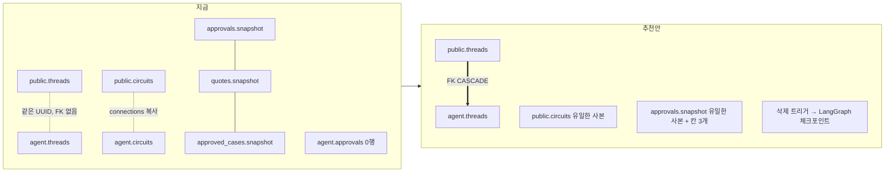

> 상태(11-12 확인): 목표(to-be) 설계는 `db/020_service_baseline.sql`로 구현되어 새 DB(compose·CI)에 적용된다. 아래 "적용하지 않은 확정 전 초안"과 현재(as-is)가 가리키는 재설계 전 운영 DB 구조는 작성 당시(11-10~11-11) 기준이고, 이 파일은 기록으로 보존한다.

# redesign

## 역할
- 이 폴더: 서비스 DB 재설계(11-11) 설계 문서. 현재 구조 문서(`as-is-*.md`), 목표 설계안(`to-be-*.md`). 일회용 Postgres 검증 스크립트는 `scripts/db/verify_redesign/`.
- 넣는 것: 설계 문서 · 검증 스크립트. 확정 · 구현된 SQL은 `db/` 바로 아래(기준선 `020_service_baseline.sql`)와 `db/migrations/`(운영 이전)에 있다. 이 폴더에는 SQL을 두지 않는다.
- 넣지 않는 것: 실제로 자동 실행되는 SQL(`db/*.sql`), 운영 DB 접속 · 백업 파일, 정본 문서(SPEC · ADR).
- 상태(통합): 기준선은 새 DB(compose · CI · 시험)에 적용되고, 운영 이전 SQL은 일회용 DB에서만 확인했다(**운영에는 아직 실행하지 않았다**).

## 파일
- `as-is-erd.md`(그림), `as-is-tables.md`(운영 DB에서 자동 생성한 표 25개 정의서 + 의미 · 소유 코드)
- `to-be-design.md`(원칙 · 선택지 비교 · 추가 조사 반영 · 시험 결과), `to-be-erd.md`, `to-be-tables.md`, `to-be-impact.md`(영향 지도 · 단계별 비용 · ADR 후보)
- `scripts/db/verify_redesign/` — 위 SQL을 일회용 Postgres 16 · 17에서 검증하는 스크립트(`run_all.sh`), 보조 코드(`lib/`), 표본 데이터(`sql/`). 운영 DB에는 접속하지 않는다

# 서비스 DB 재설계 — 검토용 요약 (정운 확정 전 초안, 11-11)

설계와 문서만 만들었다. **앱 코드 · 운영 DB는 바꾸지 않았고 어디에도 적용하지 않았다.** 범위는 서비스 표(`public` 16 + `sojafit_agent` 9)이고 코퍼스 4표 · LangGraph 표는 그대로다.

## 1. 지금 무엇이 문제인가

| # | 문제 | 근거 |
|---|---|---|
| 1 | **같은 대화 · 회로가 두 스키마에 있고 DB가 연결을 보장하지 않는다**(같은 UUID, FK 없음). 회로 연결은 2벌, 한 요청이 연결 3개 · 트랜잭션 3개로 씀 | `as-is-erd.md` ① |
| 2 | 승인 스냅샷(답 · 근거 JSON)이 3곳에 **100% 동일**하게 저장되고 그중 `quotes.snapshot`은 아무도 안 읽는다 | 조사 §4 |
| 3 | 삭제가 코드 순서에 의존한다: `sojafit_agent.*`는 RESTRICT, 체크포인트(질문 · 답 JSON)는 FK 불가라 운영자가 직접 지우면 고아로 남는다 | 조사 §5 |
| 4 | DB CHECK가 앱의 JSON 모양 · 데모 목록을 복제해 모양이 바뀔 때마다 서비스가 깨졌다(11-10 024 · 025) | `019` · `025` |
| 5 | 죽은 표 · 칸: `sojafit_agent.approvals`(0행), `circuits.netlist`(전부 빈 글자), `users.display_name`, `auth_google_pending`(이메일 평문) | 조사 §1 |
| 6 | 마이그레이션이 4갈래로 적용되고 한 번에 완성된 스키마도 이력 표(우리 것)도 없다. 레포 문서(`table-definition.md`)는 표 9개가 실제와 다르다 | 조사 §5 · §6 |
| 7 | RLS가 환경마다 다르다: 운영은 `ensure_rls` 트리거로 `public`만 ON, `sojafit_agent` · compose · CI는 OFF | 추가 조사 §4 |

## 2. 추천안 한 장

상세 ERD: [`to-be-erd.md`](to-be-erd.md), 표 정의서: [`to-be-tables.md`](to-be-tables.md), 근거 · 선택지: [`to-be-design.md`](to-be-design.md).

## 3. 선택지 비교(이중 저장, 가장 큰 결정)

| 안 | 장점 | 단점 · 위험 | 비용(코드 함수 / 시험) |
|---|---|---|---|
| A. 완전 통합(P3) | 대화 상태 표 하나 | 분석 서비스 전체 재작성, **키 없는 데모 재생이 깨질 위험** | 22 / 60+ |
| **B. 최소안(추천)** | 복사본 0, 고아 불가, 삭제를 DB가 보장. **에이전트 동작 불변** | 대화 상태는 아직 두 표(FK로 묶임) | 11 / 약 25 (P2) + SQL만으로 가능한 P1 |
| C. FK만 | 코드 변경 0 | 회로 복사본 · 죽은 표 남음 | 0 / 3 |

## 4. 단계와 비용 (일정은 정운이 정한다)

| 단계 | 내용 | 코드 함수 | 시험 | 시간 [추정] | 위험 |
|---|---|---|---|---|---|
| **P1 필수** | 승인 스냅샷 단일화 · 승인 칸, 검사 단순화, FK(대화) · 삭제 트리거, 세션 인덱스 · 만료 청소, `display_name` 삭제, 이력 표 | 3~4 | 약 11 | 5~6h | 낮음 |
| **P2 권장** | 분석 회로 사본 · 죽은 승인 경로 삭제, 소유자 CASCADE | 11 | 약 25 | 12~16h | 중간 |
| D8 권장 | 데모 계정 지연 생성(007 제거) | 1 | 2~3 | 2~3h | 낮음 |
| 2b 선택 | `auth_google_pending` + 승인 대기 코드 제거 | 5 | 약 5 | 3~4h | 낮음 |
| M 권장 | 기준선 교체(`db/020_service_baseline.sql` 하나) | 1 | 파일 7개 | 8~10h | 중간(P2 이후에만) |
| P3 · D10 보류 | 완전 통합 · 비노출 스키마 | 22 · 다수 | 60+ | 3~4일 · 1일 | 높음 |

자세한 `파일:함수` 목록은 [`to-be-impact.md`](to-be-impact.md).

## 5. 위험과 되돌리기

- 운영 이전은 **expand → 새 코드 배포 → contract** 순서이고 expand · contract P1 · contract P2가 별도 파일이다(`db/migrations/migrate_prod_*.sql`). P2 코드가 늦으면 P1까지만 하고 멈출 수 있다.
- 되돌리기: `migrate_prod_4_rollback.sql`(B2 → B1 → A, **적용의 반대 순서**). contract가 지운 것은 전부 다른 표의 복사본이거나 0행이라 **무손실로 다시 만든다**. contract 뒤에는 **코드보다 DB를 먼저** 되돌린다(옛 코드가 지운 칸을 읽음).
- 실행 전 백업 명령이 expand 파일 머리에 있다. 운영 DB에는 아직 아무것도 실행하지 않았다.

## 6. 정운이 결정할 항목 (항목마다 추천 하나)

| # | 결정 | 추천 |
|---|---|---|
| D1 | 이중 저장을 어떻게 | **B 최소안**(FK + 회로 사본 삭제 + 죽은 표 삭제). P3는 보류 |
| D2 | 승인 스냅샷 3벌 | **단일화**(`approvals` 한 곳 + 칸 3개). 승인 사례를 승인에 흡수하는 안은 보류 |
| D3 | 죽은 표 · 칸 | **삭제**(`display_name`은 SQL만 P1, 승인 경로는 코드와 함께 P2) |
| D4 | CHECK의 앱 JSON 복제 | **단순화**(필수 키 6개 / 데모일 때만 `demo_id`) |
| D5 | 인증 표 | **`auth_google_pending`만 삭제**(2b, 코드 제거 뒤). 나머지 유지 |
| D6 | 마이그레이션 | 이력 표는 **우리 `app_migrations`**(Supabase 표 아님). **증분 파일 먼저**, 기준선 교체는 P2 뒤 시간이 남으면 |
| D7 | RLS | 기준선에서 **명시**(21개 표). FORCE는 안 씀 |
| D8 | 데모 시드 | **첫 데모 로그인 때 계정 생성**(007 제거) |
| D9 | 삭제 정합성 | **체크포인트 삭제 트리거**(코드는 그대로) |
| D10 | 서비스 표를 비노출 스키마로 | **보류**(RLS + 권한 0 두 겹으로 충분) |
| D11 | 단계 범위 | **P1 + P2**(+ D8). 기준선(M)과 2b는 시간이 남으면 |
| D12 | 데모 계정 `demo1 · demo2@example.com`을 CLI로 지울 수 있게 `--delete-user-id`의 허용 범위(`@example.test`)를 넓힐지 | 지금은 **유지**(필요하면 SQL로 지운다) |

## 7. 11-10 밤 추가 조사 사실을 어디에 어떻게 반영했나

| # | 사실 | 반영한 곳 |
|---|---|---|
| 1 | Data API 켜짐 · `public`에 anon USAGE | RLS ON + 정책 0 + 권한 0(`026`). 기준선이 RLS 명시(`db/020_service_baseline.sql` 끝). `to-be-design.md` §1 · D7 · D10 |
| 2 | `ensure_rls` 트리거(운영 `public`만), compose · CI 없음 | 기준선 RLS 명시(D7). 기준선 + 026 적용 뒤 "공개 권한 0 · RLS OFF 표 0" 시험 |
| 3 | `supabase_migrations.schema_migrations` 5건, 나머지 수동 | 우리 `app_migrations` 신설, 첫 행에 `legacy-sql-000-025` 기록(D6, expand E6) |
| 4 | 프런트가 표에 묶인 3곳 | `to-be-impact.md` §6: 3곳의 응답 값 불변, 프런트 수정 0 |
| 5 | 삭제 RESTRICT · 고아 · CLI 제한 | `sojafit_agent.threads → users` CASCADE, 회로 사본 삭제, `auth_google_pending` 삭제(2b), **삭제 트리거**(D9), CLI 제한은 유지(D12) |
| 6 | 운영 PG 17.11 / compose · CI 16.15 | 모든 SQL을 **16.15와 17.11 양쪽에서 실행** 확인(`scripts/db/verify_redesign/`) |
| 7 | 007 시드 psql 전용 | D8 선택지 3개 비교, 지연 생성 추천 |
| 8 | postgres 역할 BYPASSRLS · Supavisor · FORCE RLS 0 | FORCE 미사용, 세션 advisory lock의 풀러 session 모드 의존을 가정으로 명시(`to-be-design.md` §6) |

## 8. 정정할 것 (이번 작업에서 발견)

- 11-10에 스모크 보강을 하면서 "B의 승인 · **견적 저장** POST는 승인당 견적 1개 DB 제약으로 격리가 깨져도 새로 만들지 못하고 409"라고 설명했는데 **견적은 UNIQUE가 없다**(승인당 여러 건 허용: `ix_quotes_approval`은 일반 인덱스). 승인(`message_id` UNIQUE)은 맞다. 즉 격리가 깨지면 B의 견적 POST는 A의 승인에 **견적을 실제로 만들 수 있다**(스모크는 404 기대로 실패 처리되지만 데이터는 바뀐다). `scripts/smoke/http_smoke.py`의 8-2 주석 · `SMOKE.md` 문장을 고치거나, 견적 POST를 빼야 한다. 지금 코드는 격리가 맞아 404(실제 서버 28단계 통과)라 현재 데이터 피해는 없다.

## 9. 산출물

| 경로 | 내용 |
|---|---|
| `as-is-tables.md` · `as-is-erd.md` | 현재 구조(운영 DB에서 자동 생성 + 의미 · 소유 코드) |
| `to-be-design.md` | 원칙 · 선택지 비교 · 추가 조사 반영 · 시험 결과 |
| `to-be-erd.md` · `to-be-tables.md` | 목표 구조(추천안 + 보류안), 표 정의서 + as-is 차이 |
| `db/020_service_baseline.sql` | 새 DB 기준선(16 · 17에서 실행 확인, 026 위에서도 확인). 옛 체인 + 이전 SQL 결과와 구조 차이 0 |
| `db/migrations/migrate_prod_*.sql` (`1_expand` · `2_contract_p1` · `3_contract_p2` · `2b_optional_drop_dead_auth` · `4_rollback`) | 운영 이전 SQL(운영에는 실행하지 않음) |
| `to-be-impact.md` | 파일:함수 단위 영향 지도 · 단계별 비용 · ADR 후보 |
| `scripts/db/verify_redesign/` | 위를 일회용 Postgres 16 · 17에서 검증하는 스크립트(`run_all.sh`). 운영 DB 접속 없음 |
