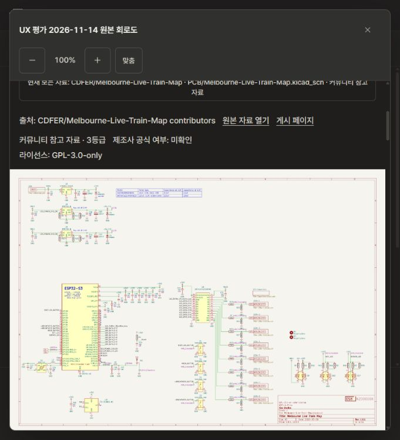
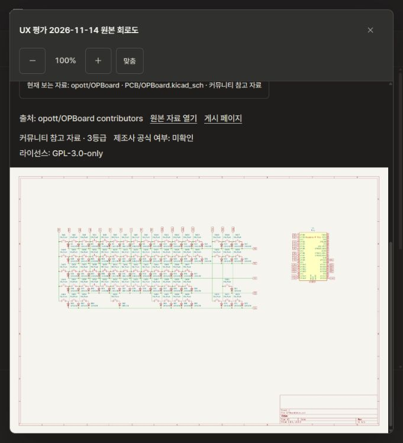

# SojaFit 프런트 오류 수정·회로도 검색 개선 공유 보고서

작성일: 2026-11-15 KST 
대상: OSC 브랜치, 로컬 서비스 `http://localhost:8011` 
코드 기준: 마지막 검증 당시 HEAD `45740ce`와 미커밋 변경 사항 
실제 검색 검증 중단 시점: 2026-11-15 04:17:11 KST

이 문서는 작업에 참여하지 않은 조원도 수정 이유, 확인된 결과, 후속 확인 대상을 알 수 있도록 작성한 인수인계 자료다. 각 작업은 **문제·원인·해결 방법·수정 내용·효과·개선점·남은 작업**으로 정리했다.

SojaFit은 회로의 부품과 사용 조건을 바탕으로 대체 부품을 검토하는 서비스다. 이번 작업은 **질문·파일 입력 과정의 오류**와 **검색한 부품이 실제로 쓰인 참고 회로도를 찾고 표시하는 과정**을 다룬다. 회로도 검색 성공은 대체 부품의 사용 승인이나 호환성 판정과는 별개다.

보고서의 수치와 화면은 작업 당시 기록이다. 문서를 정리하면서 외부 API 호출, 화면 조작, 테스트 재실행, 코드 변경을 추가하지 않았다.

## 먼저 확인할 결과

| 확인할 내용 | 현재 기록 | 조원이 알아야 할 점 |
|---|---|---|
| 입력·오류 처리 | 질문 초안 보존, 프로젝트 상태 분리, 파일 첨부·오류 안내, 지원 범위 제한을 수정 | 초기 프런트 수정은 자동 테스트와 별도 개발 화면 확인이 중심이다. 아래 항목별 검증 범위를 확인해야 한다. |
| SS33 검색 | 정상 후보 4개를 모두 선택·표시 | SS33이라는 이름의 무전기 대신 실제 SS33 사용 회로를 확인했다. 전체 웹의 누락이 없다는 뜻은 아니다. |
| CDFER 회로 | 실제 검색부터 11개 도면 표시까지 완료 | CDFER는 부품명이 아니라 공개 회로 프로젝트다. 큰 응답·파일 제한 때문에 빠지던 문제를 수정했다. |
| 1N4148 검색 | 후보 저장소 24개 검사 완료, 화면 후보 4개 모두 선택·표시 | Nozzle·matosic 등 별도 알려진 자료는 마지막 목록에서 찾지 못했다. |
| 1N4007 검색 | ajkumar 회로의 기본 표시 확인 | 외부 조회 한도가 소진돼 전체 검증과 나머지 후보 선택은 미완료다. |
| SS34·BAT54 검색 | 이전 검증 단계에서 정상 검색·표시 확인 | 마지막 공통 검색 코드 수정 이후에는 두 품번을 다시 검색하지 않았다. |
| 코드·환경 | OSC의 미커밋 변경을 로컬 8011에 반영 | `45740ce` 커밋만으로 이번 수정이 포함되는 것은 아니다. 커밋·푸시·운영 배포는 하지 않았다. |

`localhost:8011`은 검증을 수행한 PC의 로컬 주소다. 다른 조원 PC에서 같은 주소를 입력하면 해당 검증 환경에 자동 연결되지 않는다. 이 보고서의 검증 결과와 운영 서비스의 현재 상태도 구분해야 한다.

## 회로도 검색 기능은 어떻게 동작하는가

예를 들어 사용자가 ‘SS33’을 다이오드 사용 회로로 검색하면 다음 순서로 처리한다.

1. **검색 목적 확인:** 부품 SS33을 찾는지, SS33이라는 제품·보드의 회로도를 찾는지 구분한다.
2. **후보 발견:** Exa 검색과 부품 목록 색인에서 관련 GitHub 저장소를 찾는다. 검색 결과에 있다는 이유만으로 화면에 채택하지 않는다.
3. **원문 검증:** 고정된 버전의 원본 파일을 읽어 출처·라이선스·실제 부품 배치·연결된 도면을 확인한다.
4. **이미지 변환:** 원본 회로 파일이나 PDF를 화면에 표시할 이미지로 변환한다.
5. **화면 표시·후보 선택:** 출처·원본 링크와 이미지를 표시한다. 사용자가 다른 후보를 선택하면 그 회로와 출처로 바뀐다.

따라서 **검색에서 발견됨 → 원문 검증 통과 → 이미지 변환 성공 → 실제 화면 표시**는 각각 다른 확인 단계다. ‘검색에 안 나온다’는 현상도 어느 단계에서 빠졌는지 나눠 조사했다. 본문의 ‘정상 후보’는 해당 부품의 원문 배치 등을 검사한 자료라는 뜻이며, 부품 대체를 승인했다는 뜻은 아니다.

## 문서에서 사용하는 용어와 사례 이름

| 용어·이름 | 이 문서에서의 의미 |
|---|---|
| 넷리스트 | 회로의 부품과 부품 사이 연결 정보를 적은 파일. 회로도 이미지와는 다르다. |
| BOM·부품 목록 색인 | 회로에 사용된 부품 목록과 이를 검색할 수 있게 모은 정보. 후보를 찾는 데 사용하고, 최종 근거는 원본에서 다시 확인한다. |
| Exa | 외부 웹 검색 공급자. GitHub 원본 파일을 검증하거나 회로 이미지를 만드는 역할은 하지 않는다. |
| 저장소·계층·root | 저장소는 프로젝트 파일 묶음이다. 하나의 저장소에 여러 회로가 있을 수 있다. root는 연결된 여러 도면 중 시작 도면이며, 다른 하위 도면을 참조할 수 있다. |
| KiCad·심벌·Value | KiCad는 회로 설계 도구다. 심벌은 부품의 도면 기호이고 Value는 품번 등의 값이다. `Device:D`는 일반 다이오드 기호이므로 실제 품번도 함께 읽어야 한다. |
| commit·tree·SHA | 조회한 파일 버전을 고정하기 위한 Git 식별 정보. 검색 후 파일이 바뀌어도 확인한 원문 버전을 추적할 수 있게 한다. |
| metadata | 저장소 이름·라이선스·기본 브랜치·커밋 등 파일을 찾기 위한 정보. 실제 회로 파일 내용과 구분한다. |
| 렌더러·native | 렌더러는 원본 도면을 표시용 이미지로 바꾸는 구성 요소다. native 변환은 원본 KiCad 파일을 직접 변환한다는 뜻이다. |
| manifest·이미지 API | manifest는 표시할 회로의 출처·도면 수·이미지 주소를 알려주는 정보 응답이다. 실제 이미지는 별도 요청으로 읽는다. |
| 캐시·rate-limit | 캐시는 이미 확인한 결과를 잠시 보관하는 기능이다. rate-limit은 외부 서비스의 조회 횟수 제한이다. 캐시가 있어도 한도 때문에 일부 후보만 검사했을 수 있다. |
| fixture | 자동 테스트용으로 준비한 입력이나 응답. 실제 파일을 사용해도 저장소 정보 응답을 fixture로 대체했다면 전체 외부 API 검증으로 보지 않는다. |
| SPDX·GPL·CERN-OHL | 라이선스를 구분할 때 사용하는 식별 체계와 라이선스 이름. 이번 수정은 원문에 선언된 표기를 읽고 표시하는 처리이며, 새로운 이용 권한을 부여한 것이 아니다. |
| HTTP 상태 코드 | 200은 요청 성공, 401은 로그인 확인 필요를 뜻한다. 이번 조사에서는 외부 사이트의 403 거절과 서비스의 502·503 실패도 구분했다. 성공 코드만으로 모든 후보의 검사가 끝났다고 판단하지 않는다. |
| CDFER | `CDFER/Melbourne-Live-Train-Map` 공개 프로젝트. 이번에는 SS33 사용 근거를 포함한 연결 도면 11개를 표시했다. |
| Nozzle | `gongminmin/ImpulseDrive`의 `Circuit/Nozzle/Nozzle.kicad_sch` 하위 회로. 로컬 원문 검사는 통과했지만 마지막 실제 검색 목록에는 없었다. |
| matosic | `matosichrvoje/matosic-macropad-pcb` 공개 프로젝트. 별도 정상 원문 후보로 알려졌지만 최종 검색·표시 재검증은 남았다. |

## 읽는 순서

- **화면·입력 담당:** 1~6번에서 사용자가 겪던 문제와 바뀐 동작을 확인한다.
- **검색·자료 검증 담당:** 7~13번에서 외부 요청, 검색 맥락, 원문 판정, 후보 선택을 확인한다.
- **변환·운영 담당:** 14~17번에서 파일·버전 제한, 캐시, 외부 공급자 한도를 확인한다.
- **후속 검증 담당:** 문서 앞의 ‘먼저 확인할 결과’와 각 작업의 ‘남은 작업’을 확인한다.

기존 UX 점검표와 연결할 때는 본문 3번이 점검표 26번, 본문 4번이 점검표 35·36번, 본문 5번이 점검표 39번에 해당한다. 점검표를 보지 않아도 각 본문의 문제와 수정 내용을 이해할 수 있도록 작성했다.

## 검증 구분과 해석 기준

| 구분 | 의미 |
|---|---|
| 직접 검증: 실제 API·화면 | 실제 서비스 요청과 브라우저 표시를 확인한 결과. 전체 검색, 원문 검증, 이미지 조회, 후보 선택은 서로 구분한다. |
| 자동 테스트 | 격리된 테스트, TestClient, 대체 응답 등을 사용한 재현·회귀 검사. 외부 서비스와 전체 화면 흐름의 성공을 뜻하지 않는다. |
| 로컬 원문·시험용 응답 검증 | 실제 공개 파일과 이전에 받은 Git 원본을 사용하되 GitHub 저장소 정보 일부는 시험용 응답으로 대체한 검사. 실제 검색에서 발견됐다는 증거와 구분한다. |
| 미검증·부분 검증 | 한도·범위·실행 조건 때문에 끝까지 확인하지 못한 항목. 정상 자료가 없거나 문제가 해결됐다고 결론 내리지 않는다. |

각 항목의 **효과**는 확인한 동작과 검증 결과다. **개선점**은 사용자 관점의 정성적 이점이다. 재작업 시간, 구매 전환율, 매출, 사용자 만족도는 측정하지 않았으며 수치 개선을 주장하지 않는다.

## 1. 질문 전송 실패 시 초안 소실

| 항목 | 내용 |
|---|---|
| 문제 | 질문 전송을 서버가 접수하지 못했는데 입력한 질문이 사라질 수 있었다. 대기 중 새로 작성한 질문을 지울 위험도 있었다. |
| 원인 | 서버 접수 성공과 제출 당시 초안의 동일성을 충분히 확인하지 않고 입력을 초기화했다. |
| 해결 방법 | 실행 번호가 확인된 뒤 제출 당시와 같은 초안만 한 번 비우도록 했다. |
| 수정 내용 | 질문 제출·접수·초기화 시점, 대기 중 새 입력 보존, 부품 선택에서 전달한 첫 질문, 공백 포함 질문의 처리와 회귀 테스트를 수정했다. |
| 효과 | **자동 테스트:** 접수 실패 후 초안 보존, 새로 작성한 질문 보존, 첫 질문 전달과 접수 후 정리 재현 검사가 통과했다. |
| 개선점 | 통신 실패 후 질문을 다시 작성해야 하는 불편과 입력 내용 손실 위험을 줄였다. |
| 남은 작업 | 이 항목의 기록만으로 운영 API·DB 및 모든 실제 네트워크 장애 조합을 검증했다고 보지 않는다. 해당 수정의 초기 검증은 프런트 회귀 테스트 중심이었다. |

## 2. 프로젝트 간 질문·오류 상태 잔존

| 항목 | 내용 |
|---|---|
| 문제 | 다른 프로젝트로 이동했을 때 이전 프로젝트의 질문이나 부품 선택 오류가 남을 수 있었다. |
| 원인 | 화면 구성 요소와 상태가 프로젝트 전환 뒤에도 유지됐고, 상태 초기화가 실제 프로젝트 ID 변경과 충분히 연결되지 않았다. |
| 해결 방법 | 실제 프로젝트 ID가 바뀔 때 관련 입력과 오류를 초기화했다. |
| 수정 내용 | 작업대의 프로젝트 전환 처리와 관련 회귀 테스트를 수정했다. |
| 효과 | **자동 테스트:** 프로젝트 전환 시 질문·오류가 섞이는 재현 검사가 통과했다. |
| 개선점 | 다른 회로에 이전 질문을 잘못 보내거나 이전 오류를 현재 문제로 오해하는 혼란을 줄였다. |
| 남은 작업 | 운영 환경의 모든 전환·통신 경합 조합은 확인하지 않았다. |

## 3. 파일 첨부 제한 안내

| 항목 | 내용 |
|---|---|
| 문제 | 단일 파일 처리 정책과 파일 선택·드롭 동작이 명확히 맞지 않았다. 추가 첨부 시 기존 파일과 질문을 잃을 수 있다는 혼란이 있었다. |
| 원인 | 단일 선택, 다중 파일 드롭, 기존 첨부가 있는 상태의 추가 파일 처리가 일관되지 않았다. |
| 해결 방법 | 단일 파일 정책을 입력 시점에 적용하고, 추가 파일은 안내하면서 기존 첨부와 질문을 유지했다. |
| 수정 내용 | 파일 선택창 단일 선택, 여러 파일 드롭 거절, 추가 파일 안내, 동일 파일 중복 무시를 반영했다. |
| 효과 | **자동 테스트·화면 확인:** 기존 첨부·초안 유지와 두 번째 파일 거절을 확인했다. 초기 화면 검증은 별도 5192 프런트를 기존 8011 API에 연결해 수행했다. |
| 개선점 | 무엇이 첨부됐는지 명확해지고, 잘못된 추가 선택으로 기존 입력을 잃는 위험을 줄였다. |
| 남은 작업 | 여러 파일 동시 분석은 지원하지 않는다. 이 초기 화면 확인에서는 실제 업로드 POST를 수행하지 않았으므로 그 확인을 업로드 전체 성공으로 확대하지 않는다. |

## 4. 업로드 오류 원인 구분

| 항목 | 내용 |
|---|---|
| 문제 | 파일 업로드 실패 시 인코딩 문제인지, 넷리스트 문법 문제인지, 요청 형식 문제인지 사용자가 이해하기 어려웠다. |
| 원인 | 서로 다른 입력 오류가 충분히 구분되지 않아 복구 방법을 안내하기 어려웠다. |
| 해결 방법 | 오류 종류를 나누고 각각 재저장·재내보내기 등의 안내를 제공했다. |
| 수정 내용 | UTF-8 디코딩 오류 분류, 넷리스트 문법 오류 안내, multipart 요청 형식 오류의 안전한 응답 변환을 반영했다. 기존 HTTP 400·VALIDATION_ERROR 계약과 내부 예외 비노출을 유지했다. |
| 효과 | **자동 테스트·TestClient:** 두 업로드 경로의 인코딩·문법·multipart 오류 응답을 확인했다. 당시 관련 API·넷리스트 검사 기록은 100 passed, 1 skipped였다. |
| 개선점 | 사용자가 파일을 어떻게 고쳐야 하는지 판단할 수 있게 했다. |
| 남은 작업 | 모든 회로 설계 도구의 출력 형식과 운영 DB를 포함한 전체 업로드 조합을 검증한 것은 아니다. |

## 5. 지원 범위 밖 부품의 새 검토 차단

| 항목 | 내용 |
|---|---|
| 문제 | 서비스 지원 범위 밖의 부품도 화면 선택이나 직접 URL을 통해 새 검토를 시작할 수 있었다. |
| 원인 | 선택 화면과 직접 진입 경로의 제한이 일관되지 않았고, 저장 기록 열람과 새 입력의 경계가 충분히 분리되지 않았다. |
| 해결 방법 | 범위 밖 부품의 새 검토를 막으면서 기존 저장 기록은 읽을 수 있게 했다. |
| 수정 내용 | 부품 선택, 직접 진입, 질문·첨부·예시·재개 입력 제한과 기록 조회 실패 안내를 수정했다. 다이오드 새 대화 전환 시 입력·실시간 답변 흐름을 유지하도록 했다. |
| 효과 | **자동 테스트·화면 확인:** 범위 밖 선택 비활성화, 직접 URL 안내, 저장된 서버 대상 복원을 확인했다. |
| 개선점 | 지원 가능한 범위와 읽기 가능한 과거 기록을 구분해 잘못된 사용 기대를 줄였다. |
| 남은 작업 | 다이오드 외 부품의 분석 지원 확대는 구현하지 않았다. |

## 6. 출처·원본 링크·확인 상태·후보 버튼 안내

| 항목 | 내용 |
|---|---|
| 문제 | 회로도의 출처와 원본 링크가 잘 보이지 않았고, 제조사 공식 여부와 라이선스 상태가 혼동됐다. 당시 표시된 회로도 후보 선택 버튼도 용도를 알기 어려웠다. |
| 원인 | 출처 배치와 문구가 사용자의 판단 순서에 맞지 않았고, 자료 분류·공식 여부·이용 조건을 함께 읽기 어려웠다. |
| 해결 방법 | 이미지 위에서 출처와 확인 상태를 먼저 읽도록 하고, 후보 선택 시 바뀌는 내용을 명시했다. |
| 수정 내용 | 이미지 위 출처·원본 자료 열기·게시 페이지 배치, 상태 문구 분리, ‘현재 보는 자료/이 자료 보기’, 선택 시 회로도와 출처 변경 안내, 선택 상태와 스타일을 수정했다. 기존 캐시 키 불일치 테스트도 선택을 포함하는 키에 맞췄다. |
| 효과 | **실제 API·화면:** 출처와 링크가 이미지 위에 표시되고, 확대 시에도 위치가 유지되는 것을 확인했다. 이후 후보 전환과 출처 변경도 확인했다. |
| 개선점 | 근거 추적, 현재 선택 식별, 자료 비교가 쉬워졌다. |
| 남은 작업 | 출처 표시만으로 제조사 공식성이나 법적 이용 가능성을 새로 보증하지 않는다. 라이선스 미확인 자료의 조건은 별도 확인 대상이다. |

## 7. 외부 회로도 후보 502 오류

| 항목 | 내용 |
|---|---|
| 문제 | Elektrotanya의 검색 후보를 선택하면 회로도가 열리지 않고 서비스에서 502가 발생했다. |
| 원인 | 실제 외부 이미지 요청에서 기본 python-httpx 식별값은 HTTP 403을 받았다. Referer 단독으로 해결되지 않았고 서비스 User-Agent를 명시한 요청은 HTTP 200이었다. |
| 해결 방법 | 공개 이미지 요청에 서비스 식별값을 명시했다. |
| 수정 내용 | public_asset 요청에 `SojaFit/1.0 (schematic viewer)` User-Agent를 적용했다. 허용 호스트·크기 제한·인증 헤더 경계는 유지했다. |
| 효과 | **실제 API·화면:** 해당 후보의 회로도 정보 응답과 이미지 요청이 각각 HTTP 200으로 성공했고, 재선택 후 3060×1980 이미지 로드를 확인했다. |
| 개선점 | 검색에서 찾은 후보를 실제로 열 수 있게 됐다. |
| 남은 작업 | 외부 사이트의 향후 응답 정책이나 지속 가용성은 통제할 수 없다. 이 자료를 다이오드 사용 회로로 채택한 것은 아니며, 이후 검색 맥락 수정에서 무관한 무전기 자료는 제외했다. |

## 8. SS33 다이오드 검색에 무전기 회로도가 나오는 문제

| 항목 | 내용 |
|---|---|
| 문제 | SS33 다이오드를 검색했는데 Ranger SS33 무전기 회로도가 나왔다. |
| 원인 | 같은 문자열을 쓰는 제품과 부품의 검색 의도를 구분하지 못했고, 품번 문자열만으로는 실제 다이오드 사용 근거를 확인할 수 없었다. |
| 해결 방법 | 제품·보드 회로도와 다이오드 사용 회로의 검색 목적을 분리하고 부품 근거를 요구했다. |
| 수정 내용 | 검색 목적 전달, 다이오드 맥락, 한국어 정규화, 무전기 충돌 조건, 목적별 캐시와 결과 초기화, 실제 배치 품번 검증을 반영했다. |
| 효과 | **실제 API·화면:** 다이오드 모드에서 Ranger 후보가 제외되는 것을 확인했다. 이후 정상 SS33 사용 회로가 표시됐고 최종 관찰 결과에서도 무전기 자료는 없었다. |
| 개선점 | 사용자가 입력한 부품을 실제로 쓰는 회로에 검색을 맞췄다. |
| 남은 작업 | 전체 웹에서 오탐이 전혀 없음을 증명한 것은 아니다. |

## 9. 실제 사용 회로 검색 범위 확대

| 항목 | 내용 |
|---|---|
| 문제 | 실제 정상 사용 회로가 존재해도 검색에서 찾지 못했다. |
| 원인 | 저장소 이름 중심의 제한된 검색과 후보 상한에 의존했다. 공개 색인 순위가 바뀌면 정상 후보가 검사에 도달하지 못했다. |
| 해결 방법 | BOM 색인과 서로 다른 GitHub 검색 경로를 결합하고 검색·검사 예산을 일치시켰다. |
| 수정 내용 | BOM 색인, GitHub 저장소·파일 검색 경로, 후보 중복 제거와 교차 수집을 적용하고 최종 후보 상한을 24개로 통일했다. 색인은 발견에만 사용하고 원문·라이선스·배치는 다시 검증한다. |
| 효과 | **실제 API·화면:** 기존 결과 외의 회로가 추가됐다. 최종 SS33은 4개, 1N4148은 4개 정상 후보를 표시했다. |
| 개선점 | 사용자에게 자료 선택권이 늘고 특정 저장소 이름에 의존하는 편향이 줄었다. |
| 남은 작업 | 색인 누락·순위 변동·24개 상한은 남는다. 정상 자료 전체를 반드시 찾는 기능은 아니다. |

## 10. 일반·사용자 정의 다이오드 심벌의 정상 자료 누락

| 항목 | 내용 |
|---|---|
| 문제 | `Device:D` 같은 일반 심벌이나 사용자 정의 심벌을 쓴 정상 회로가 제외됐다. 구형 KiCad의 인스턴스 값에 있는 품번도 놓칠 수 있었다. |
| 원인 | 특정 심벌 라이브러리 이름이나 한 가지 품번 기록 방식에 치우친 분류였다. 같은 다이오드도 일반 기호에 품번을 적거나 계층별 부품 정보에 값을 기록할 수 있었다. |
| 해결 방법 | 실제 배치된 참조번호·품번과 심벌 구조를 함께 확인했다. |
| 수정 내용 | 일반 다이오드 기호를 지원하고, 설명과 양극·음극 핀(A/K 또는 A/C) 구조를 함께 검사했다. 원본 부품 식별값(UUID)과 참조번호가 맞는 계층별 품번 정보도 읽도록 했다. 광다이오드·LED·레이저 제외와 정확 품번 검증은 유지했다. |
| 효과 | **자동 테스트·실제 API·화면:** 일반 심벌과 사용자 정의 BAT54의 정상 사례가 통과했고, 여러 품번의 정상 회로 표시를 확인했다. |
| 개선점 | 회로 작성 방식에 따라 정상 자료가 탈락하는 편향을 줄였다. |
| 남은 작업 | 모든 KiCad 작성 방식과 심벌의 의미를 완전히 해석하는 것은 아니다. |

## 11. 라이선스 표기 차이로 인한 정상 자료 누락

| 항목 | 내용 |
|---|---|
| 문제 | 라이선스 선언이 있는 정상 저장소도 검증에서 제외될 수 있었다. |
| 원인 | 오래된 SPDX 식별자와 구조화된 짧은 CERN 고지의 표현을 충분히 인식하지 못했다. |
| 해결 방법 | 명확한 별칭을 정규화하고 고정 원문의 선언과 적용 범위를 함께 확인했다. |
| 수정 내용 | GPL 식별자 별칭 처리, 정해진 구조의 CERN 고지와 README에 적힌 하드웨어 설계 파일 전체의 적용 범위 검사, 라이선스 근거 링크를 반영했다. `NOASSERTION`은 선언된 라이선스를 확정하지 못한 상태이므로 일괄 허용하지 않았다. |
| 효과 | **자동 테스트·실제 API·화면:** 해당 조건을 충족한 정상 원문이 통과했고 CDFER의 GPL-3.0-only, jolly의 CERN-OHL-S-2.0 등의 표시를 확인했다. |
| 개선점 | 확인 가능한 선언을 표기 차이 때문에 놓치는 일을 줄였다. |
| 남은 작업 | 라이선스 불명 자료는 여전히 제외 대상이다. 제조사 공식 여부와 법적 이용 가능성 전체를 보증하는 변경은 아니다. |

## 12. 독립 회로·완전한 하위 계층의 누락

| 항목 | 내용 |
|---|---|
| 문제 | 한 저장소에 여러 회로가 있거나 상위의 다른 시트를 읽지 못하면, 정상 사용 회로까지 함께 제외됐다. |
| 원인 | 한 저장소에는 시작 회로(root)가 하나라고 가정했고, 최상위 회로 전체가 검사돼야 한다고 처리했다. Nozzle 도면 자체는 정상인데 같은 프로젝트의 다른 하위 도면인 Power의 계층별 부품 표기를 읽지 못해 함께 제외됐다. |
| 해결 방법 | 검색 부품을 포함한 완전한 계층을 개별 선택하고, 완전한 하위 계층도 별도 후보로 지원했다. |
| 수정 내용 | 독립 계층 분리, 완전한 하위 root 선택, 완전한 상위 후보가 있으면 하위 후보 중복 제거를 적용했다. 선택 계층 자체의 누락·순환 검사는 유지했다. |
| 효과 | **실제 API·화면:** SS34의 정상 독립 회로와 1N4148의 KBDevBoard 하위 회로 표시를 확인했다. **로컬 원문·시험용 응답:** Nozzle은 실제 파일로 두 품번 검사를 통과했지만 GitHub 저장소 정보는 시험용 응답을 사용했다. |
| 개선점 | 저장소의 다른 시트나 프로젝트 때문에 사용할 수 있는 회로까지 탈락하는 문제를 줄였다. |
| 남은 작업 | Nozzle의 최종 실제 검색 발견·표시는 확인하지 못했다. Power 시트의 표현을 파서가 모두 지원하게 고친 것은 아니다. matosic도 최종 미노출로 남았다. |

## 13. 다른 정상 회로 선택과 결과 혼합 방지

| 항목 | 내용 |
|---|---|
| 문제 | 한 결과에 의존하거나 다른 후보를 선택했을 때 어떤 회로가 표시됐는지 혼동할 수 있었다. |
| 원인 | 서로 다른 원본 회로와 같은 회로의 여러 파일 포맷을 구분하는 선택·캐시 경계가 부족했다. |
| 해결 방법 | 고정 커밋과 원본 root별 선택 목록을 만들고, 선택한 원문의 표시 결과를 유지했다. |
| 수정 내용 | 커뮤니티 후보 목록과 현재 선택을 표시하고, 해당 검색에서 검증된 URL만 선택하도록 했다. 같은 회로의 PDF·이미지·KiCad 파일 사이에서만 대체해 읽으며, 실패했다고 다른 회로를 대신 표시하지 않는다. 검색어를 입력하는 중의 불필요한 조회도 막았다. |
| 효과 | **실제 API·화면:** 최종 SS33·1N4148 후보 각각 4개 모두 선택·표시했다. 다른 검색의 임의 URL 차단과 선택 실패 동작은 자동 테스트로 확인했다. |
| 개선점 | 여러 정상 자료를 비교하고 현재 근거를 추적하기 쉬워졌다. |
| 남은 작업 | 표시 후보 전체의 지속 가용성을 보장하지 않는다. 마지막 1N4007의 추가 후보 선택은 중단 조건 때문에 미검증이다. |

## 14. 큰 원문·KiCad 버전·구형 포맷의 렌더링 실패

| 항목 | 내용 |
|---|---|
| 문제 | 정상 회로 원문이 있어도 파일이 크거나 형식이 달라 렌더링되지 않았다. 열 수 없는 구형 native 후보가 선택 목록에 나올 수도 있었다. |
| 원인 | 큰 파일의 공유 파서 제한, KiCad 9와 10 형식 차이, 구형 `.sch` 직접 렌더링 미지원이 겹쳤다. |
| 해결 방법 | 업로드 파서의 제한을 바꾸지 않고 렌더러 검사 방식을 보완하고 지원 버전을 갱신했다. 표시할 수 없는 native 후보는 제외했다. |
| 수정 내용 | 큰 파일을 구조 단위로 나눠 검사하되 파일 전체와 개별 도형·부품의 검사 제한을 유지했다. 렌더러는 KiCad 10.0.8로 갱신했다. 구형 회로에 연결된 PDF·이미지는 계속 제공하고, 원문 형식 오류와 외부 서버 요청 실패를 구분했다. |
| 효과 | **실제 API·화면:** jolly 2장, CDFER 11장, aqleds의 구형 원문에 연결된 PDF 4장 표시를 확인했다. |
| 개선점 | 지원 가능한 정상 원문의 표시 범위를 넓히고 열리지 않는 후보를 줄였다. |
| 남은 작업 | 구형 `.sch` 원본의 직접 렌더링은 미지원이다. 모든 KiCad 버전·포맷을 지원한다고 보지 않는다. |

## 15. CDFER의 선행 metadata·원문 크기 제한

| 항목 | 내용 |
|---|---|
| 문제 | 렌더러가 원문을 처리할 수 있어도 CDFER가 실제 검색 결과에서 계속 빠졌다. |
| 원인 | 두 단계에서 각각 막혔다. 먼저 `/commits/main`은 필요한 버전 정보 외의 큰 변경 내용도 반환해 440,091바이트가 됐고 정보 응답 상한 256KiB를 넘었다. 이를 해결해도 연결 원문 11개 합계 13,036,966바이트가 기존 원문 읽기 상한 12MiB를 넘었다. |
| 해결 방법 | 필요한 고정 SHA만 작은 branch 응답으로 얻고, 원문 읽기 예산을 렌더러 범위와 맞췄다. |
| 수정 내용 | 같은 고정 버전·파일 목록 식별값을 4,448바이트로 제공하는 branch API를 사용했다. 원문 읽기는 총 25MiB까지 허용했다. 정보 응답 상한, 파일당 4MiB, 128파일, 20시트, 고정 버전·라이선스·품번 검증은 유지했다. CDFER만 통과시키는 예외는 등록하지 않았다. |
| 효과 | **실제 API·화면:** CDFER가 검색 후보에 포함됐고 고정 버전 `f628db0917e4a076e77e99ff934c330375196ae1`의 11장 모두 로드됐다. 출처·원본 링크·GPL-3.0-only가 이미지 위에 표시됐다. |
| 개선점 | 정상적인 큰 회로 프로젝트가 불필요한 metadata와 과도하게 낮은 읽기 예산 때문에 제외되는 문제를 해결했다. |
| 남은 작업 | 설정한 크기·파일·계층 상한을 넘는 자료는 계속 제외될 수 있다. 전체 웹의 모든 정상 대형 회로를 검증한 것은 아니다. |

## 16. 부분 결과 캐시와 한도 복구 후 재검사

| 항목 | 내용 |
|---|---|
| 문제 | 일부 후보만 확인한 결과가 GitHub 한도 복구 후에도 전체 결과처럼 남을 수 있었다. |
| 원인 | 일부 정상 후보를 찾은 뒤 조회 한도에 막혀도 그 부분 목록을 저장했다. 한도가 복구돼도 기본 검색과 후보 선택에 저장된 결과를 함께 갱신하지 못할 수 있었다. |
| 해결 방법 | 최초 검사에서 재검사 시점을 기록하고, 시간이 지나면 동일 검색의 관련 캐시를 갱신하도록 했다. |
| 수정 내용 | 재시도 대기 중에는 확인된 정상 후보를 계속 사용하게 했다. 재검사 시각이 지나면 같은 검색의 기본·선택 캐시를 함께 비운다. 사용자가 후보를 반복 선택해도 그 시각을 늦추지 않으며, 저장 개수 제한과 동시 접근 보호를 적용했다. 검사 요약 로그에는 검색어·인증정보·이미지 토큰을 넣지 않았다. |
| 효과 | **자동 테스트:** 복구 후 새 후보 재검사와 오래된 선택 캐시 제거가 통과했다. **실제 API·화면:** 한도 복구 후 1N4148 후보 24개를 오류 없이 검사하고 최종 후보 4개를 모두 표시했다. |
| 개선점 | 외부 한도로 생긴 누락이 캐시에 계속 고정되는 문제를 줄였다. |
| 남은 작업 | GitHub 익명 한도 자체는 남는다. 부분 결과의 존재를 전체 원문 검사 완료로 해석하면 안 된다. |

## 17. 외부 공급자 오류와 서비스 오류의 구분

| 항목 | 내용 |
|---|---|
| 문제 | 정상 자료를 읽을 수 있어도 전체 검색이 외부 공급자 상태 때문에 실패하거나 부분 결과만 반환했다. |
| 원인 | Exa가 실제 HTTP 402를 반환한 시점과 GitHub 익명 한도 소진이 있었다. |
| 해결 방법 | 검색 공급자·원문 검증·렌더링·이미지 조회를 분리해 어느 단계가 막혔는지 확인했다. Exa는 사용자가 상태를 복구한 뒤 재검증했다. |
| 수정 내용 | 회로도 404와 외부 502·503의 구분 및 부분 검사 로그를 유지·보완했다. Exa 결제·계정 상태를 코드로 해결한 것으로 기록하지 않았다. |
| 효과 | **실제 API·화면:** 복구 뒤 검색에서 서비스 화면까지 재검증했다. 최종 구간의 검색 API 404·502·503은 0건이었으나 일부 검색에는 내부 GitHub rate-limit이 있었다. |
| 개선점 | 정상 자료 없음, 검증 실패, 외부 장애, 한도 부족을 구분할 수 있게 했다. |
| 남은 작업 | 공급자의 가용성과 한도는 외부 조건이다. 사용자 요청에 따라 마지막 한도 소진 뒤 추가 대기는 중단했다. |

## 검증 기록과 보존 범위

- 마지막 코드 검증 기록: 백엔드 관련 6개 파일 **293 passed**, 전체 프런트 9개 파일 **194 passed**. 이 보고서 작성 중 다시 실행한 수치가 아니다.
- 마지막 실검증 구간: manifest 11회와 이미지 26장, 합계 **HTTP 200 37건**. 관찰한 26장 모두 `complete=true` 및 양수 원본 크기 확인.
- 검색 API 404·502·503: 0건. GitHub 한도 오류가 발생한 부분 결과는 별도로 기록했다.
- 로그인 세션 만료 HTTP 401: 1건. 기존 계정으로 재로그인해 재실행했으며 회로도 원문 오류와 구분한다.
- renderer `/render`: HTTP 200 8건, 4xx/5xx 0건.
- production build와 `git diff --check` 통과 기록이 있다. 실제 코드·API·화면 검증과 자동 테스트의 범위는 위 항목별 구분을 따른다.
- 코드 작업에서는 기존 dirty·미추적 파일을 백업하고 범위 밖 변경을 보존했다. 마지막 수정 작업 기준 범위 밖 45개 파일과 기존 worklog prefix의 동일성을 확인했다.
- 8011에 반영했으며 운영 서비스 배포는 하지 않았다. 코드 수정 단계에서 필요한 renderer 갱신을 했고, 마지막 API 수정 구간에는 실행 환경값·DB·renderer 컨테이너를 유지했다.
- 커밋·푸시는 하지 않았다. 이 문서는 작업 폴더 밖의 공유용 보고서를 저장소로 복사하고 근거 링크를 상대 경로로 맞춘 사본이다. 서비스 코드는 수정하지 않았다.

## 근거 자료와 화면

관련 코드를 찾을 때 아래 경로를 사용한다. 경로는 각 조원의 **코드 저장소 최상위 폴더 기준**이다. 전체 작업의 관련 위치를 안내하는 표이며, 마지막 수정 단계에서 이 파일을 모두 변경했다는 뜻은 아니다.

| 확인할 내용 | 관련 위치 |
|---|---|
| 질문 초안·프로젝트 전환 | `frontend/src/hooks/useConversation.ts`, `frontend/src/pages/WorkbenchPage.tsx` |
| 파일 첨부·업로드 오류 | `frontend/src/hooks/useNetlistFiles.ts`, `frontend/src/components/NetlistIntake.tsx`, `backend/projects/netlist.py`, `backend/api/projects.py` |
| 회로도 출처·후보 선택 화면 | `frontend/src/components/Schematic.tsx`, `frontend/src/styles/app.css` |
| 검색·원문 검증·캐시 | `backend/projects/external_circuit_search.py`, `backend/projects/schematic_discovery.py`, `backend/projects/schematic_source.py`, `backend/projects/external_schematic.py` |
| 이미지 변환·회로도 API | `backend/projects/schematic_render.py`, `backend/projects/schematic.py`, `backend/api/external_circuits.py`, `Dockerfile` |

- [기존 최종 검색 검증 보고서](schematic-search-verification-2026-11-15.md)
- [후보·원본 링크·이미지 로드 관찰 기록](../../scripts/results/smoke/schematic_search_observations_2026-11-15.json)
- 코드 저장소 내 작업 로그: `docs/worklog/osc.md`. [작업 로그 열기](../worklog/osc.md)

