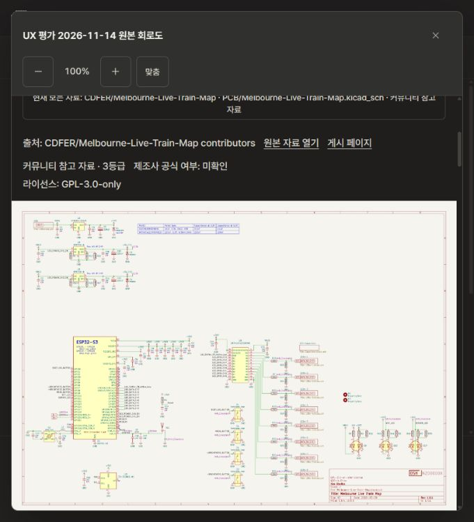
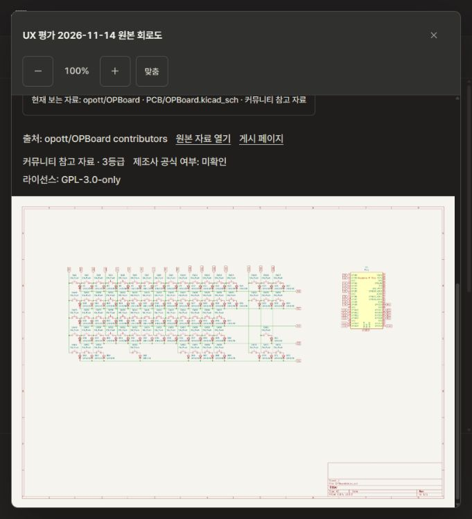

# 회로도 검색 누락 수정 및 실제 검증 보고서

2026-11-15 KST · 로컬 OSC / localhost:8011 · HEAD `45740ce`

확인된 누락 원인을 수정해 8011 API에 반영했다. CDFER 회로 11장과 최종 1N4148 후보 4개의 실제 검색·선택·이미지 표시를 확인했다. 04:17:11에 GitHub 익명 잔여 한도 0회를 확인했고, 사용자의 “다음 한도가 소진되면 멈추고 보고서 작성” 요청에 따라 추가 검색·선택 검증·초기화 대기를 중단했다. 모든 정상 자료의 누락이 해결됐다는 결론은 아니다.

**원인과 수정**

| 원인 | 직접 확인한 근거 | 반영한 수정 |
|---|---|---|
| 정상 후보가 검색·검사 상한 밖으로 밀림 | Exa 검색 결과 순서가 호출마다 달라졌고 세 검색 경로를 합친 뒤 12개로 제한했음 | BOM 색인 및 GitHub 두 경로와 서비스 검사 상한을 공유 24개로 통일 |
| CDFER의 커밋 상세 응답이 너무 큼 | 실제 `/commits/main`은 HTTP 200이나 440,091바이트여서 256KiB metadata 제한에서 거부됨. `/branches/main`은 동일 commit/tree SHA를 4,448바이트로 반환 | 고정 SHA 획득에 branch API 사용. metadata 크기 제한과 SHA 검증은 유지 |
| 정상 CDFER 계층이 원문 검사 예산을 넘음 | 실제 연결된 KiCad 11개 파일 합계 13,036,966바이트로 기존 12MiB 예산 초과 | 전체 discovery 읽기 예산을 렌더러와 같은 25MiB로 조정 |
| 상위 계층의 다른 시트 때문에 정상 하위 사용 회로까지 제외 | Nozzle 시트는 1N4148·1N4007 배치와 배선이 통과하지만, 상위 MPD의 Power 시트에 있는 계층별 인스턴스 주석을 현재 파서가 충돌로 거절 | 검색 부품을 포함한 하위 계층 자체가 완전하면 별도 원문 후보로 제공. 완전한 상위 계층이 있으면 하위 후보 중복 제거 |
| 한도에 막힌 부분 결과가 캐시에 남음 | 일부 성공과 rate-limit을 함께 저장해 복구 후에도 부분 목록을 재사용할 수 있었음 | 최초 검사 때 재검사 시점 기록. cooldown 후 동일 검색의 기본·선택 캐시를 함께 비움. 반복 선택은 시점을 연장하지 않음 |

라이선스 허용 목록, 실제 배치 품번 일치, 무전기·다른 품번 제외, 파일당 4MiB, 파일 수 128개, 선택 계층 20시트, 누락 child·순환 거절은 유지했다. 특정 품번이나 저장소를 성공 결과로 등록하지 않았다. branch 응답 계약은 [GitHub 공식 문서](https://docs.github.com/en/rest/branches/branches#get-a-branch)와 실응답을 대조했다.

**실제 API와 서비스 화면 결과**

| 대상 | 최종 검색 검사 상태 | 화면에서 직접 확인한 결과 | 아직 확인하지 못한 것 |
|---|---|---|---|
| SS33 | 후보 24개 검사 완료, rate/upstream 오류 없음 | EmaNeg 2장, jollydodo 2장, aqleds 4장, CDFER 11장. 표시 후보 4개 모두 선택 성공 | 검색 후보 24개 밖의 전체 웹 자료 |
| CDFER | 실제 metadata→branch→tree→원문 검증 및 검색 후보 포함 | 고정 commit `f628db0917e4a076e77e99ff934c330375196ae1`, GPL-3.0-only, 출처·원본 링크 표시. 11장 모두 로드 완료 | 없음: 이번에 요구한 검색→선택→11장 표시 경로는 확인 완료 |
| 1N4148 | 복구 후 후보 24개 검사 완료, rate/upstream 오류 없음 | LMN-3-ECAD, hiralsinghal/Keyboard, sol/KBDevBoard, opott/OPBoard. 최종 표시 후보 4개를 각각 선택해 1장씩 정상 표시 | Nozzle·matosic 등 별도 알려진 정상 원문은 최종 목록에 없었으며, 이번 한도 안에서 해당 누락 단계를 끝까지 추적하지 못함 |
| 1N4007 | 한도 소진으로 부분 검사 | 기존 실행 중이던 검색이 ajkumar/POWER-ELECTRONICS-LIB의 dc-motor-speed-controller를 기본 표시. 이미지 3508×2481 로드 완료. 이전에 놓쳤던 정상 원문이 실제 표시됨 | 같은 저장소의 transformerless 및 Srushti 후보는 목록에 있으나 이번 중단 시점 이후 선택하지 않음. 뒤쪽 저장소 검증도 미완료 |

`24/24 inspected`는 검사 루프의 시도 수다. rate-limit이 발생한 검색을 원문 24개 모두 검증한 것으로 세지 않았다. source 수는 PDF·이미지·native 포맷별 수이며, 화면 후보 수는 같은 원문 root를 합친 수다.

최종 SS33 풀은 source 4개·화면 후보 4개, 최종 1N4148 풀은 source 5개·화면 후보 4개였다. 1N4007은 source 4개·화면 후보 3개가 반환됐지만 rate-limit이 있어 부분 결과로 기록했다. 앞선 부분 1N4148 검색에서 SnaggingCobra/hackpad도 정상 표시됐으나 마지막 검색 목록에는 나타나지 않았다. 공개 색인의 순위 변동과 제한된 후보 범위에 따른 누락 가능성은 남는다.

관찰한 결과에 무전기나 다른 품번의 회로는 없었다. 전체 웹에 무관한 결과나 정상 자료 누락이 없음을 증명한 것은 아니다. Nozzle은 현재 코드와 실제 로컬 Git 원문·metadata fixture에서 두 품번 모두 통과했지만, 최종 실제 검색 API의 발견·표시는 확인하지 못했다. matosic의 현행 원문 검증도 이번 최종 구간에서는 다시 수행하지 않았다.

**응답과 자동 검사**

- 최종 코드 실검증 구간: manifest 11회와 이미지 26장, 합계 HTTP 200 37건. 기록한 26장 모두 `complete=true`, 양수 원본 크기 확인.
- 검색 API 404·502·503: 0건. 일부 검색의 GitHub 한도 오류는 내부 풀 로그에 기록됐고 API는 확인된 부분 결과를 반환했다.
- 로그인 세션 만료 HTTP 401: 1건. 기존 검증 계정으로 재로그인한 뒤 같은 프로젝트에서 다시 검색했다. 회로도 원문 오류와 구분한다.
- renderer `/render`: HTTP 200 8건, 4xx/5xx 0건.
- 백엔드 관련 6개 시험 파일: **293 passed**. 시작 백업 코드에서 대형 commit diff·후반 후보·quota 복구 회귀가 실패하는 것도 확인했다.
- 전체 프런트 시험: **194 passed**, 9개 파일.
- Docker API production build, TypeScript/Vite 빌드, `git diff --check` 통과.

백엔드 실행 명령은 `PYTHON_DOTENV_DISABLED=1`, `TEST_AUTH_DATABASE_URL` 비움 상태에서 `uv run --no-sync pytest -q tests/projects/test_external_circuit_search.py tests/projects/test_schematic_discovery.py tests/projects/test_schematic_render.py tests/projects/test_external_schematic.py tests/projects/test_official_schematic.py tests/api/test_external_circuits.py -p no:cacheprovider`였다. 프런트는 `npm run test:run`으로 확인했다.

**보존 범위와 제한**

작업 시작 시 dirty·미추적 53개 파일을 임시 백업했고, 요청 범위 밖 45개 파일의 SHA-256 동일성을 확인했다. 기존 worklog 바이트도 보존했다. 수정 범위는 검색·검증·캐시 모듈 3개, 해당 시험 파일 3개, 폴더 설명과 작업 로그 2개다. 8011 API만 재생성했으며 실행 환경값과 DB·renderer 컨테이너는 유지했다. 기존 회로·대화, DB 스키마, 주요 루트 문서, 평가셋은 변경하지 않았다. 커밋·푸시·운영 배포는 하지 않았다.

실제 Exa 검색과 공개 원문 HTTP 요청을 사용했다. 유료 LLM·모델 평가 호출은 하지 않았고 외부 검색 비용 금액은 별도 측정하지 않았다. 보고서는 정해진 중단 시점까지 확인한 사실을 다루며, 1N4007 전체 검증이나 모든 정상 원문의 검색 성공을 완료로 처리하지 않는다.

**화면과 관찰 자료**

원본 링크·후보 목록·이미지 로드 상태와 크기는 [관찰 기록](../../../scripts/results/smoke/schematic_search_observations_2026-11-15.json)에 보관했다. 상세 작업 기록은 `docs/worklog/osc.md`에 남겼다.
