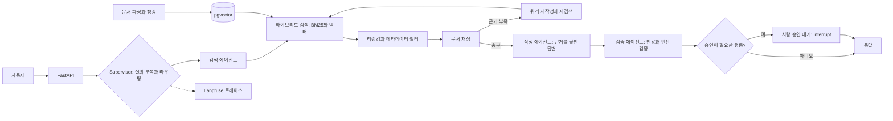

# 아키텍처와 조원 계약서

조의 설계를 그림과 글로 남기는 자리입니다. 발표와 `EVAL_REPORT.md`가 이 문서를 가리킵니다. 아래 요청 흐름은 프로젝트를 시작할 때의 초기 안입니다. 지금 그래프 구조는 `SPEC.md` 2절 "그래프"와 [MULTI_AGENT.md](../backend/multi_agent/MULTI_AGENT.md)를 따르고, 초기 안의 검색 · 작성 · 검증 에이전트는 RAG 에이전트 · 대체 부품 에이전트로 바뀌었습니다.

## 요청 흐름 (초기 안)

## 조가 채울 것

| 질문 | 답 |
|---|---|
| 왜 그래프인가(분기, 반복, 승인이 왜 필요한가) | |
| Supervisor와 서브에이전트는 각각 무엇을 책임지고, 무엇을 서로 모르게 하는가(컨텍스트 격리) | |
| 어디서 사람 승인(interrupt)을 받는가, 왜 거기인가 | |
| 체크포인트에서 무엇이 저장되고 어떻게 재개되는가 | |
| 로그인한 사용자 id가 thread와 Store namespace에 어떻게 들어가는가 | |
| 무엇을 State에 두고 무엇을 Store에 두는가 | |
| 벡터DB는 무엇이고 왜 골랐는가(선택 이유와 한계) | |
| 신뢰 경계: 코퍼스 안의 지시문(간접 인젝션)은 어디서 막는가 | |

## 조원 간 계약서 (조가 채울 것, 병렬로 일하기 전에 먼저 씁니다)

여럿이 동시에 일하면 함수 시그니처만 맞춰서는 부족합니다. 예를 들어 `retrieve()`의 `parts` 필터는 `warmup()`이 표지 청크로 만든 품번 색인에 기대고, 색인에 없는 품번만 받으면 `[]`를 돌려줍니다(`docs/specs/rag-pipeline.md`). 판정 쪽이 이 의존을 모르면 코퍼스에 새로 들어온 품번도 "문서로 확인 안 됨"으로 볼 수 있습니다. 시그니처에 보이지 않는 이런 의존을 아래 표가 가리키는 문서에 적습니다. 같은 내용을 두 곳에 적지 않으려고 이 표는 정본 위치만 둡니다.

| 항목 | 내용 |
|---|---|
| 각자 수정할 수 있는 경로 | 폴더별 담당 역할은 `SOJAFIT.md`의 "폴더 설명 파일과 담당" 표, 역할별 사람은 `README.md` 7절 조원 표. 주요 문서(루트 문서 6개, `docs/adr/`)는 조장만 고칩니다(`AGENTS.md` 팀 규칙 3) |
| 모듈 사이의 함수와 시그니처 | `retrieve()` 시그니처와 HTTP API 경로 · 본문 · 상태 코드는 `SPEC.md` 4절. 그 밖의 함수는 각 폴더 설명 파일과 모듈 첫머리 설명 |
| 의존하는 파일과 환경변수 | 환경변수 이름과 뜻은 `.env.example`, 코드가 읽는 파일은 각 폴더 설명 파일의 "파일" 목록 |
| 오프라인 규칙 | `SPEC.md` 7절(데모 모드 · 오프라인 규칙) |

## 결정 기록

바꿀 때마다 한 줄씩 남깁니다. `날짜 | 무엇을 | 왜 | 대안`

| 날짜 | 무엇을 | 왜 | 대안 |
|---|---|---|---|
| 2026-11-01 | 코퍼스를 TSC 다이오드 13개 분류의 데이터시트 1,360건(품번 9,589개)으로 정함. Infineon과 다른 부품 종류(MOSFET 등)는 다이오드 판정 기능이 완성된 뒤 넓힘 | 평가 회로의 다이오드 역할(역극성 보호, 플라이백, 제너 클램프, 정류, ESD/TVS)에 맞는 분류가 TSC 13개 분류에 모두 있고, 평가 문항이 묻는 품번(1N5817~19, 1N4148, BZT52, SS34, BZX84)이 다 들어 있음. 약관상 재배포가 허용되고, 한 제조사라 데이터시트 양식이 같아 파싱·청킹 규칙 하나로 다룰 수 있음 | TSC와 Infineon을 함께 수집 |
| 2026-11-01 | 파서를 Docling(모든 쪽) + 합친 칸 채우기 + pdfplumber 대조로 정함 | 파서 5종 원문 대조(값 41개)에서 Docling 41, pdfplumber 36, pdftotext 33. 합친 칸은 어느 도구든 채워야 했음 | pdfplumber만 쓰기(더 빠르지만 36/41) |
| 2026-11-01 | 청킹 3종(개선 전 고정 1000자·겹침 100자, 개선 1 Docling HybridChunker, 개선 2 표 한 행 = 조각 하나 + 이름표 + 품번 표지)을 비교한 뒤 D2 검색 점수로 고름 | PDF 3건 대리 지표에서 개선 전과 개선 2가 같은 41/41이고, 이 지표는 조각이 클수록 유리함 | 대리 지표만으로 고름 |
| 2026-11-01 | 청킹을 개선 2(표 한 행 = 청크 하나 + 이름표 + 품번 표지, 표 밖 글은 Docling HybridChunker)로 정함 | 사전 등록 #3 검색 비교(비동결 관련 11문항, dense만)에서 개선 전 → 개선 2가 문서 Recall@5 0.455 → 0.727, MRR 0.321 → 0.568. 11문항이라 통계로는 구별되지 않음(부호 검정 양측 p=0.25) | 개선 전(고정 1000자·겹침 100자) |
| 2026-11-02 | Infineon과 다른 부품 종류(MOSFET 등)는 3차 범위에서 넓히지 않고 지원 가능 품목(확장 후보)으로만 둠(조장 결정, SPEC 6절) | `data/manifest.jsonl`은 한 줄 평균 346바이트라 약 1,480줄에서 Checkpoint 대시보드가 읽는 512,000바이트를 넘고, Infineon(280~430건)을 더하면 다시 넘을 수 있음 | 다이오드 판정 기능이 완성된 뒤 넓힘(11-01 기록) |

## 반복 운영 확인

- 매 작업일 15분 스탠드업에서 담당·차단 이슈·다음 작업을 기록한다.
- 주간 20분 전원 점검을 하고 각자의 주담당·보조 담당과 다음 할 일을 확인한다.
- 실제 담당·수정 경로는 위 계약 표가 가리키는 `SOJAFIT.md` 담당 표와 `README.md` 조원 표에서 관리한다.
